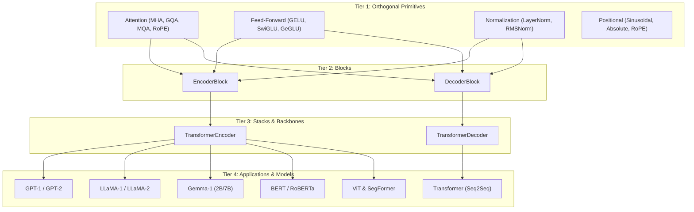

# StackFormer Architecture Overview

StackFormer structures Transformer development into four clean, hierarchical abstraction tiers:



---

## 1. Tier 1: Orthogonal Primitives

At the lowest level, `stackformer.modules` houses orthogonal building blocks:
- **Attention Modules**: Calculate token-to-token contextual representations.
- **Feed-Forward Networks (FFN)**: Apply point-wise non-linear feature projections across channels.
- **Normalization**: Rescale activations across hidden dimensions to maintain stable gradients.
- **Positional Embeddings**: Inject sequence position awareness into permutation-invariant attention matrices.

Each primitive is implemented with consistent tensor shape expectations:
- Sequence input: `(Batch, Sequence, EmbedDim)` or `(B, T, C)`.
- Attention heads: `(Batch, Heads, Sequence, HeadDim)` or `(B, H, T, D)`.

---

## 2. Tier 2: Blocks (`EncoderBlock` & `DecoderBlock`)

A Transformer block wires attention, feed-forward, and normalization sub-layers together with residual connections.

StackFormer supports two primary block designs:
- **`EncoderBlock`**: Consists of self-attention followed by an FFN, each surrounded by residual additions and normalization. Used in encoder models (BERT, ViT) and causal decoder models (GPT, LLaMA, Gemma).
- **`DecoderBlock`**: Consists of causal self-attention, cross-attention (attending over external memory from an encoder), and an FFN. Used in sequence-to-sequence models (Vaswani Transformer).

---

## 3. Tier 3: Stacks (`TransformerEncoder` & `TransformerDecoder`)

Backbone stacks chain $N$ identical blocks together:
- Accept a single `BlockConfig` and instantiate $N$ layers via `nn.ModuleList`.
- Optionally apply initial positional embeddings (`sinusoidal` or `absolute`) at the input.
- Optionally apply a final normalization layer before emitting hidden states.

```python
from stackformer.modules import BlockConfig, TransformerEncoder

cfg = BlockConfig(embed_dim=512, num_heads=8, ffn="swiglu", norm="rmsnorm")
encoder = TransformerEncoder(cfg, num_layers=12)
```

---

## 4. Tier 4: Model Zoo

The top tier bundles backbones with task-specific embeddings and projection heads:
- Causal Language Models: Embeddings + Encoder Stack (with causal mask) + `lm_head` linear projection.
- Masked Language Models: Embeddings (Token + Position + Segment) + Encoder Stack + MLM projection head.
- Vision Models: Patch Embedding Conv/Linear + Encoder Stack + Classifier head.
- Sequence-to-Sequence: Source Embedding + `TransformerEncoder` + Target Embedding + `TransformerDecoder` + Generation head.

