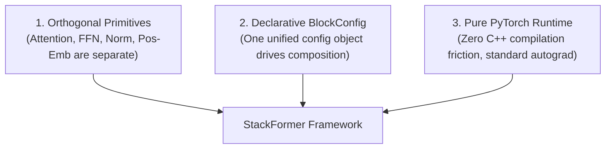

# StackFormer Fundamentals

This section covers the core architectural principles, building blocks, and layer primitives that power StackFormer.

---

## Architectural Philosophy

StackFormer is built around three foundational pillars:

1. **Orthogonal Layer Primitives**: Layer behaviors are isolated into independent, reusable modules. Modifying the feed-forward activation function does not require touching attention code or normalization layers.
2. **Declarative Composition**: Rather than hardcoding connections or writing complex inheritance trees, `BlockConfig` dictates how sub-layers instantiate and connect.
3. **Pure PyTorch Runtime**: Every layer inherits from `torch.nn.Module`, operates on standard `torch.Tensor` objects, and executes without external C++ compilation dependencies.

---

## Guide Index

Explore the fundamentals in detail:

- **[Architecture Overview](architecture-overview.md)**: Software hierarchy from attention heads to multi-stage vision and language models.
- **[Block Composition](block-composition.md)**: Deep dive into `BlockConfig`, `EncoderBlock`, `DecoderBlock`, and backbone stacks.
- **[Attention Mechanisms](attention-mechanisms.md)**: Multi-Head Attention, Grouped-Query Attention, Multi-Query Attention, RoPE variants, and scaled dot-product execution.
- **[Positional Embeddings](positional-embeddings.md)**: Sinusoidal encodings, learned absolute embeddings, and Rotary Position Embeddings (RoPE).
- **[Normalization](normalization.md)**: LayerNorm vs RMSNorm, and pre-normalization vs post-normalization stability.
- **[Feed-Forward Networks](feed-forward-networks.md)**: Canonical FFN activations (GELU, ReLU) and gated linear units (SwiGLU, GeGLU).

