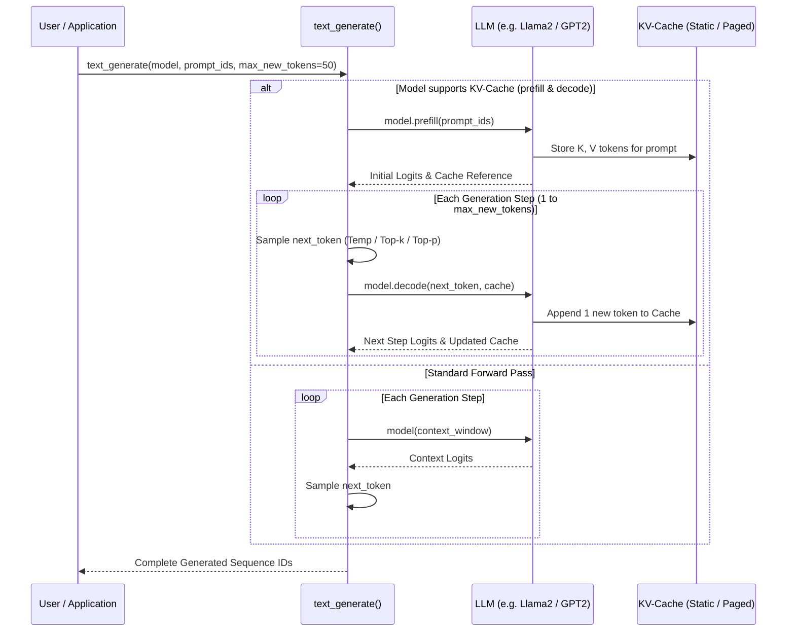

# Text Generation & KV Caching

StackFormer provides an autoregressive sequence generation engine designed for LLM inference. It supports both standard forward execution and high-performance **Key-Value (KV) Cache** acceleration with pluggable sampling strategies.

---

## Architectural Workflow



---

## Core Capabilities

| Capability | Module | Description |
| :--- | :--- | :--- |
| **`text_generate()`** | `stackformer.generate` | Autoregressive decoding loop handling context window capping, EOS token detection, and sampling. |
| **`GenerationConfig`** | `stackformer.config` | Dataclass configuring maximum sequence length, temperature, top-k, and nucleus top-p thresholds. |
| **`StaticKVCache`** | `stackformer.cache.static` | Pre-allocated contiguous buffer cache `(B, H, Lmax, D)` eliminating dynamic tensor allocations. |
| **`PagedKVCache`** | `stackformer.cache.paged` | Block-pool virtual memory KV cache inspired by vLLM, allocating fixed-size physical blocks on demand. |
| **Sampling Strategies** | `stackformer.generate` | Mathematically sound implementations of Greedy, Temperature, Top-K, and Top-P (Nucleus) sampling. |

---

## Quick Example: Generating Text

```python
import torch
from stackformer.models import GPT2
from stackformer.generate import text_generate

# 1. Initialize Model
model = GPT2(vocab_size=1000, num_layers=4, embed_dim=256, num_heads=4, seq_len=128)
model.eval()

# 2. Provide prompt token IDs
prompt = torch.tensor([[45, 128, 9, 312]])

# 3. Generate tokens with temperature and nucleus sampling
output = text_generate(
    model=model,
    prompt_ids=prompt,
    max_new_tokens=20,
    temperature=0.8,
    top_p=0.9,
    top_k=50,
)

print("Generated tokens:", output.tolist())
```

---

## Detailed Generation Guides

- [Text Generation API](text-generation.md): Using `text_generate()`, stopping on EOS, and `GenerationConfig`.
- [KV-Cache Architectures](kv-cache.md): Memory analysis of `StaticKVCache` vs `PagedKVCache`.
- [Prefill and Decode Contract](prefill-and-decode.md): How models implement `prefill()` and `decode()` for fast inference.
- [Sampling Strategies](sampling-strategies.md): Mathematical formulations for temperature, top-k, and nucleus sampling.

