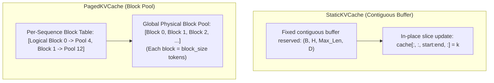

# Key-Value (KV) Caching

During autoregressive generation, each new token attends to all previous tokens in the sequence. Without a KV-cache, computing token $t$ requires recomputing attention keys and values for all earlier positions $1 \dots t-1$, resulting in $\mathcal{O}(T^2)$ computational complexity for generating a sequence of length $T$.

A **KV-Cache** caches previously computed key and value vectors in GPU memory, reducing per-token decoding complexity from $\mathcal{O}(t)$ to $\mathcal{O}(1)$ compute operations.

StackFormer provides two distinct KV-cache strategies inside `stackformer.cache`:
1. **`StaticKVCache`**: Pre-allocated contiguous tensor buffers.
2. **`PagedKVCache`**: Block-pool virtual memory allocation inspired by vLLM.

---

## Architectural Comparison



| Dimension | `StaticKVCache` | `PagedKVCache` |
| :--- | :--- | :--- |
| **Memory Allocation** | Contiguous tensor `(B, H, Lmax, D)` | Shared physical block pool `(num_blocks, H, block_size, D)` |
| **Allocation Timing** | Upfront static pre-allocation | On-demand dynamic block reservation |
| **Memory Fragmentation** | Higher (reserves worst-case `max_len`) | Minimal (near-zero fragmentation) |
| **CUDA Graph Support** | Excellent (fixed tensor pointers) | Requires dynamic index gathers |
| **Variable Sequence Batches** | Padding required | Variable lengths natively supported |

---

## `StaticKVCache`

`StaticKVCache` reserves fixed memory buffers during initialization. It avoids memory reallocation and fragmentation spikes during generation.

### Allocation & Lifecycle

```python
from stackformer.cache import StaticKVCache

cache = StaticKVCache()

# 1. Allocate buffers for max_len=256
cache.allocate(
    batch_size=2,
    num_heads=8,
    head_dim=64,
    max_len=256,
    device="cuda",
    dtype=torch.float32,
)

# 2. Update cache with prompt keys & values (start_pos=0, prompt_len=10)
cache.update(k_prompt, v_prompt, start_pos=0)

# 3. Retrieve stored keys & values
k_all, v_all = cache.get_kv(seq_len=10)

# 4. In decoding step: update 1 new token at position 10
cache.update(k_new, v_new, start_pos=10)
k_all, v_all = cache.get_kv(seq_len=11)
```

---

## `PagedKVCache`

`PagedKVCache` partitions key-value memory into small, fixed-size physical blocks (e.g., 16 tokens per block) stored in a unified memory pool.

### Why Paged KV-Cache?
In standard contiguous caches, if you configure `max_len=2048` but the prompt and generation only consume 150 tokens, the remaining 1898 token slots sit unused in memory. `PagedKVCache` allocates blocks dynamically as tokens are generated, freeing unused memory for larger batch sizes.

### Allocation & Lifecycle

```python
from stackformer.cache import PagedKVCache

paged_cache = PagedKVCache()

# Allocate shared pool with block_size=16 tokens
paged_cache.allocate(
    batch_size=4,
    num_heads=8,
    head_dim=64,
    max_len=512,
    device="cuda",
    dtype=torch.float16,
    block_size=16,
)

# Update and retrieve
paged_cache.update(k_tokens, v_tokens, start_pos=0)
k_gathered, v_gathered = paged_cache.get_kv(seq_len=current_length)
```

---

## Memory Efficiency Comparison

For a model with $L=12$ layers, $H=12$ heads, $D=64$, generating 100 tokens with `max_len=2048` across batch size $B=8$:

- **Uncached Forward Pass**: Recomputes all previous token keys/values on every step ($\mathcal{O}(T^2)$ FLOPs).
- **Contiguous Cache (`StaticKVCache`)**: Allocates for $2048$ tokens per sequence $\rightarrow \approx 384\text{ MB}$ reserved.
- **Paged Cache (`PagedKVCache`)**: Allocates only 7 blocks ($7 \times 16 = 112$ slots) per sequence $\rightarrow \approx 21\text{ MB}$ reserved ($\sim 18\times$ memory savings).

