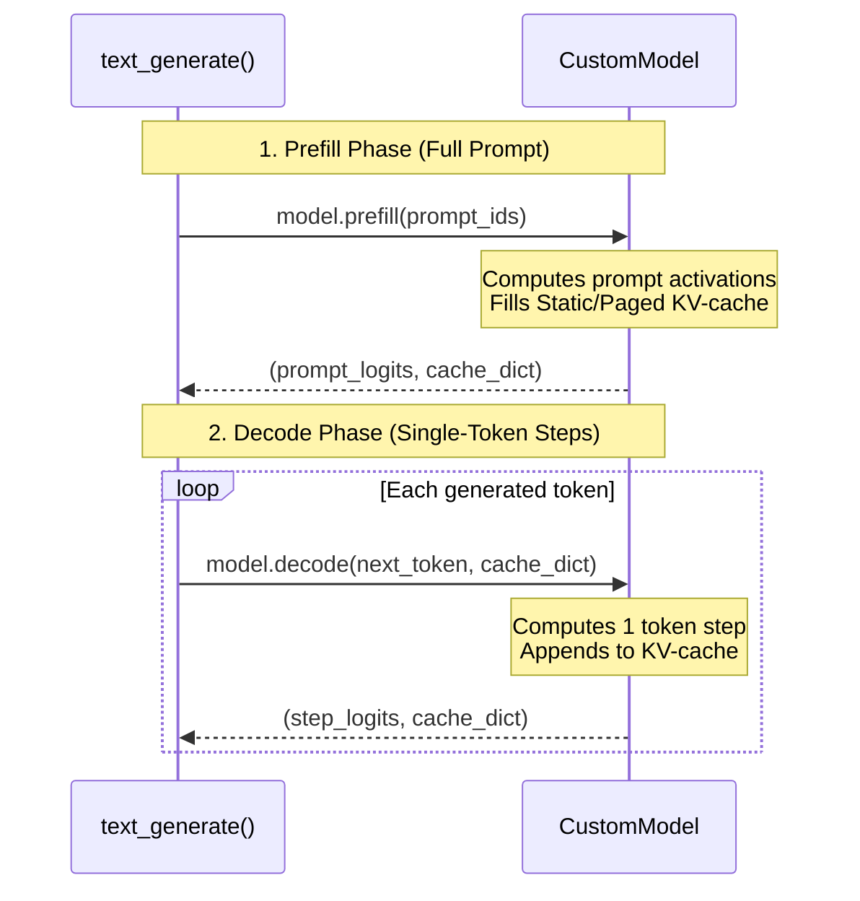

# Prefill and Decode Interface

Modern LLM inference consists of two distinct operational phases:
1. **Prefill Phase**: Ingesting the full prompt sequence in parallel to populate the initial KV-cache and compute logits for the first new token.
2. **Decode Phase**: Generating tokens one-by-one autoregressively, retrieving past keys/values from the KV-cache and projecting only the single newly generated token.

StackFormer formalizes this separation through the **Prefill & Decode Model Contract**, allowing models to seamlessly plug into `text_generate()` for hardware-accelerated generation.

---

## The Prefill & Decode Contract

To enable fast KV-cached inference, a StackFormer model exposes:
1. `supports_kv_cache = True`
2. `prefill(input_ids: torch.Tensor) -> tuple[torch.Tensor, dict]`
3. `decode(next_token: torch.Tensor, cache: dict) -> tuple[torch.Tensor, dict]`



---

## Method Specifications

### `prefill(input_ids)`

- **Input**:
  - `input_ids`: Prompt token IDs tensor of shape `(Batch, Seq_Len)`.
- **Operations**:
  - Allocates or resets layer KV-caches.
  - Computes self-attention across the full prompt.
  - Stores key and value vectors for all prompt tokens in the cache.
- **Returns**:
  - `logits`: Full sequence logits tensor of shape `(Batch, Seq_Len, Vocab_Size)`.
  - `cache`: Dictionary or container storing per-layer KV cache references.

### `decode(next_token, cache)`

- **Input**:
  - `next_token`: Single newly generated token ID tensor of shape `(Batch, 1)`.
  - `cache`: The cache container returned by `prefill` or the previous `decode` call.
- **Operations**:
  - Computes Queries ($Q$) for the single token `(B, 1, D)`.
  - Computes Keys ($K$) and Values ($V$) for the single token `(B, 1, D)`.
  - Appends new $K, V$ to the cache.
  - Computes attention of the single query $Q$ against all cached keys and values.
- **Returns**:
  - `logits`: Single-position logits tensor of shape `(Batch, 1, Vocab_Size)`.
  - `cache`: Updated cache container.

---

## Implementing the Contract on a Custom Model

Here is how to equip a custom model with prefill and decode capabilities:

```python
import torch
import torch.nn as nn
from stackformer.cache import StaticKVCache

class CachedLanguageModel(nn.Module):
    def __init__(self, vocab_size: int, embed_dim: int, num_heads: int, max_len: int = 512):
        super().__init__()
        self.supports_kv_cache = True
        self.vocab_size = vocab_size
        self.max_len = max_len
        self.token_emb = nn.Embedding(vocab_size, embed_dim)
        self.lm_head = nn.Linear(embed_dim, vocab_size, bias=False)

    def prefill(self, input_ids: torch.Tensor) -> tuple[torch.Tensor, dict]:
        b, seq_len = input_ids.shape
        cache = {"kv": StaticKVCache(), "step": seq_len}
        cache["kv"].allocate(batch_size=b, num_heads=4, head_dim=32, max_len=self.max_len, device=input_ids.device, dtype=torch.float32)
        
        # Forward pass on full prompt
        hidden = self.token_emb(input_ids)
        logits = self.lm_head(hidden)
        return logits, cache

    def decode(self, next_token: torch.Tensor, cache: dict) -> tuple[torch.Tensor, dict]:
        # Fast decode step for a single token
        hidden = self.token_emb(next_token)
        logits = self.lm_head(hidden)
        cache["step"] += 1
        return logits, cache
```

---

## Execution Fallback

When passing a standard model to `text_generate()` that does **not** implement `prefill()` and `decode()`:
1. `text_generate()` automatically detects the absence of the contract.
2. It safely falls back to standard autoregressive execution (`model(context_window)`).
3. No exceptions are raised, ensuring 100% backward compatibility with arbitrary PyTorch modules.

