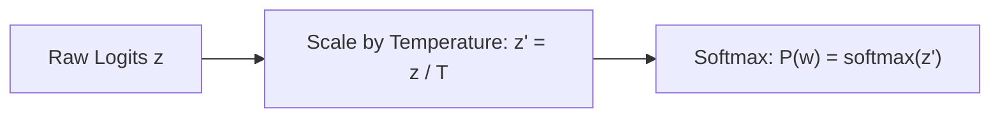
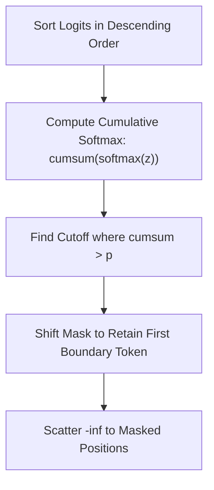

# Sampling Strategies

Autoregressive language models output an unnormalized vector of logits $\mathbf{z} \in \mathbb{R}^V$ representing scores for each vocabulary item at the next position. How next tokens are selected from these logits dramatically affects output coherence, creativity, and diversity.

StackFormer implements sampling in `_sample_next_token` inside `stackformer.generate`, supporting **Temperature Scaling**, **Top-K Filtering**, and **Nucleus (Top-P) Sampling**.

---

## 1. Temperature Scaling

Temperature $T > 0$ controls the flatness or peakiness of the probability distribution by scaling logits before softmax:

$$P(w_i) = \frac{\exp(z_i / T)}{\sum_{j=1}^V \exp(z_j / T)}$$



### Effects of Temperature
- **Low Temperature ($T \to 0$, e.g. $T = 0.1$–$0.3$)**: Sharpens the distribution toward the highest-scoring tokens. Approaches greedy argmax decoding. Ideal for deterministic tasks like coding, mathematical reasoning, and factual retrieval.
- **Moderate Temperature ($T = 0.7$–$0.9$)**: Balances grammatical fluency with expressive vocabulary. Standard for conversational agents and general writing.
- **High Temperature ($T > 1.0$)**: Flattens probabilities across vocabulary, producing highly exploratory and creative—but potentially ungrammatical or hallucinated—text.

---

## 2. Top-K Filtering

Top-K sampling restricts candidate tokens to the $k$ most probable vocabulary entries. All tokens outside the top-$k$ set have their logits masked to $-\infty$:

$$z'_i = \begin{cases} z_i & \text{if } i \in \text{Top-K}(\mathbf{z}) \\ -\infty & \text{otherwise} \end{cases}$$

StackFormer implements this via tensor scattering:

```python
if top_k is not None and top_k > 0:
    top_k = min(top_k, logits.size(-1))
    topk_vals, topk_indices = torch.topk(logits, top_k, dim=-1)

    filtered = torch.full_like(logits, float("-inf"))
    filtered.scatter_(dim=-1, index=topk_indices, src=topk_vals)
    logits = filtered
```

### Advantage
Eliminates the "long tail" of low-probability nonsense tokens that could otherwise be selected during random multinomial sampling.

---

## 3. Top-P (Nucleus) Sampling

Introduced by Holtzman et al. (*The Curious Case of Neural Text Degeneration*, 2019), Nucleus Sampling dynamically adjusts the number of candidate tokens based on the shape of the probability distribution.

Instead of keeping a fixed count $k$, it selects the smallest set of tokens whose cumulative probability exceeds threshold $p \in (0, 1]$:

$$\sum_{i \in V^{(p)}} P(w_i) \ge p$$



StackFormer implements cumulative probability masking with proper index preservation:

```python
if top_p < 1.0:
    sorted_logits, sorted_indices = torch.sort(logits, descending=True, dim=-1)
    probs = F.softmax(sorted_logits, dim=-1)
    cumulative_probs = torch.cumsum(probs, dim=-1)

    sorted_mask = cumulative_probs > top_p
    # Shift mask right by 1 so we keep the first token exceeding threshold
    sorted_mask[..., 1:] = sorted_mask[..., :-1].clone()
    sorted_mask[..., 0] = False

    remove_mask = torch.zeros_like(sorted_mask)
    remove_mask.scatter_(dim=-1, index=sorted_indices, src=sorted_mask)
    logits = logits.masked_fill(remove_mask, float("-inf"))
```

### Why Top-P Outperforms Fixed Top-K
- **Peaked Distributions**: When the model is very confident (e.g. after "The capital of France is"), the top token may hold $95\%$ of probability mass. Top-P restricts the candidate set to just 1 token, preventing bad choices.
- **Flat Distributions**: When many possibilities exist (e.g. "She opened the door and saw a"), Top-P expands the candidate set to 50+ tokens, preserving natural diversity.

---

## Recommended Sampling Presets

| Use Case | Temperature | Top-K | Top-P | Characteristics |
| :--- | :--- | :--- | :--- | :--- |
| **Deterministic / Code** | `0.1` | `10` | `0.95` | Highly predictable, low variance |
| **Factual QA** | `0.4` | `40` | `0.90` | Accurate, minimal hallucination |
| **General Chat** | `0.7` | `50` | `0.90` | Balanced, engaging, fluent |
| **Creative Writing** | `0.9` | `100` | `0.95` | Expressive, varied vocabulary |

