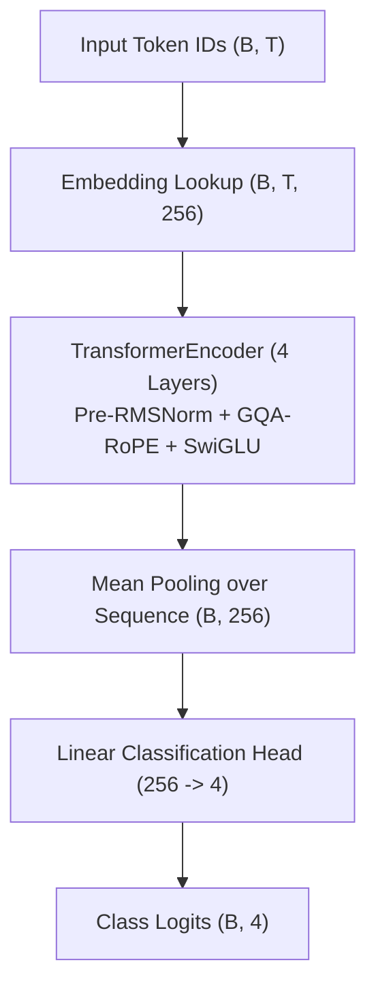

# Build Your First Custom Transformer

This tutorial walks through building a complete, custom Transformer architecture from scratch using StackFormer primitives.

You will learn how to:
1. Define token embeddings and input representations.
2. Configure custom Transformer blocks with `BlockConfig`.
3. Assemble a multi-layer backbone with `TransformerEncoder`.
4. Attach a classification or language modeling head.
5. Inspect tensor shapes and execute forward passes.

---

## Architecture Design

We will construct a modern encoder network featuring:
- **Embedding dimension**: $d = 256$
- **Attention mechanism**: Grouped-Query Attention with Rotary Embeddings (`gqa_rope`)
- **Feed-forward network**: SwiGLU with 1024 hidden dimension
- **Normalization**: Pre-RMSNorm
- **Task**: 4-class sequence classifier



---

## Step-by-Step Implementation

### Step 1: Define the Architecture Class

```python
import torch
import torch.nn as nn
from stackformer.modules import BlockConfig, TransformerEncoder

class CustomTextClassifier(nn.Module):
    """Custom Transformer text classification model built with StackFormer."""

    def __init__(
        self,
        vocab_size: int = 10000,
        embed_dim: int = 256,
        num_heads: int = 8,
        num_kv_heads: int = 2,
        num_layers: int = 4,
        num_classes: int = 4,
        max_seq_len: int = 128,
        dropout: float = 0.1,
    ):
        super().__init__()
        
        # 1. Token Embedding layer: (B, T) -> (B, T, C)
        self.embedding = nn.Embedding(vocab_size, embed_dim)
        
        # 2. Block configuration
        # Note: Since we use 'gqa_rope', rotary position encodings are handled
        # inside the attention heads. No separate pos_embedding is needed.
        self.block_cfg = BlockConfig(
            embed_dim=embed_dim,
            num_heads=num_heads,
            num_kv_heads=num_kv_heads,
            hidden_dim=4 * embed_dim,
            attention="gqa_rope",
            ffn="swiglu",
            norm="rmsnorm",
            pre_norm=True,
            dropout=dropout,
        )
        
        # 3. Stacked Encoder Backbone
        self.encoder = TransformerEncoder(
            cfg=self.block_cfg,
            num_layers=num_layers,
            pos_embedding=None,  # Handled by RoPE
            max_seq_len=max_seq_len,
        )
        
        # 4. Final classification head
        self.classifier = nn.Linear(embed_dim, num_classes)

    def forward(self, input_ids: torch.Tensor, mask: bool = False) -> torch.Tensor:
        # Step A: Embed token IDs
        # input_ids: (B, T) -> x: (B, T, C)
        x = self.embedding(input_ids)
        
        # Step B: Pass through Transformer encoder stack
        # x: (B, T, C) -> features: (B, T, C)
        features = self.encoder(x, mask=mask)
        
        # Step C: Global average pooling over sequence length
        # (B, T, C) -> (B, C)
        pooled = features.mean(dim=1)
        
        # Step D: Project to class logits
        # (B, C) -> (B, num_classes)
        logits = self.classifier(pooled)
        return logits
```

---

### Step 2: Instantiate and Test Forward Pass

Now instantiate the model and pass a batch of token sequences:

```python
# Create model instance
model = CustomTextClassifier(
    vocab_size=8000,
    embed_dim=256,
    num_heads=8,
    num_kv_heads=2,
    num_layers=4,
    num_classes=4,
)

# Create synthetic input batch: Batch=2, Sequence=32
sample_input = torch.randint(0, 8000, (2, 32))

# Execute forward pass
logits = model(sample_input)

print("Input shape: ", sample_input.shape)
print("Output logits shape:", logits.shape)

assert logits.shape == (2, 4), "Output dimension mismatch!"
print("Model initialized and forward pass verified!")
```

**Expected output**:
```text
Input shape:  torch.Size([2, 32])
Output logits shape: torch.Size([2, 4])
Model initialized and forward pass verified!
```

---

### Step 3: Train with the `Trainer` Engine

You can plug your custom model directly into StackFormer's `Trainer`:

```python
from torch.utils.data import DataLoader, TensorDataset
from stackformer.engine import Trainer

# 1. Create synthetic dataset
x_train = torch.randint(0, 8000, (64, 32))
y_train = torch.randint(0, 4, (64,))
dataset = TensorDataset(x_train, y_train)
loader = DataLoader(dataset, batch_size=8, shuffle=True)

# 2. Configure loss function for classification
criterion = nn.CrossEntropyLoss()

# 3. Train
trainer = Trainer(
    model=model,
    train_dataloader=loader,
    criterion=criterion,
    device="cpu",
    max_epochs=2,
    max_train_steps=5,
    lr=1e-3,
    checkpoint_dir="checkpoints/custom_classifier",
)
trainer.fit()
```

---

## Key Takeaways

1. **Orthogonal Configuration**: You built a model combining RoPE, GQA, and SwiGLU in under 50 lines of readable code.
2. **Flexible Heads**: Replacing `self.classifier` with `nn.Linear(embed_dim, vocab_size)` instantly turns this network into a generative decoder or masked language model.
3. **Hardware Agnostic**: Runs transparently on CPU, MPS, or CUDA.

