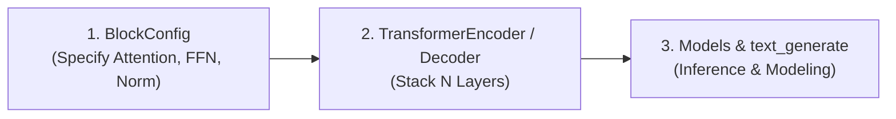

# Getting Started with StackFormer

Welcome to StackFormer! This section provides everything you need to go from an initial installation to building, configuring, and training your first Transformer models.

---

## Learning Path

We recommend following this sequence if you are new to StackFormer:

1. **[Installation](installation.md)**: Set up Python, PyTorch, and StackFormer via PyPI or from source.
2. **[Quickstart](quickstart.md)**: A 5-minute hands-on walkthrough demonstrating block configuration, model instantiation, training, and text generation.
3. **[Build Your First Transformer](first-transformer.md)**: A step-by-step tutorial explaining how token embeddings, `BlockConfig`, and `TransformerEncoder` connect to form a complete network.
4. **[Configuration Guide](configuration.md)**: Master `ModelConfig` and `GenerationConfig` dataclasses for reproducible experiments.

---

## Prerequisites

- **Python**: Version `3.10`, `3.11`, or `3.12`.
- **PyTorch**: Version `>= 2.0` (PyTorch 2.3+ recommended for optimal `F.scaled_dot_product_attention` performance).
- **Core Hardware**: Standard CPU, Apple Silicon (MPS), or NVIDIA GPU (CUDA).

---

## Key Concepts in 60 Seconds

StackFormer simplifies Transformer development through three core components:

- **`BlockConfig`**: Instead of manually wiring sub-layers, specify the hyperparameters (e.g. `attention="gqa_rope"`, `ffn="swiglu"`, `norm="rmsnorm"`) in a single dataclass.
- **Backbone Stacks**: Pass `BlockConfig` to `TransformerEncoder` or `TransformerDecoder` with `num_layers=N` to produce a deep network backbone.
- **Inference & Generation**: Autoregressively generate text with `text_generate()` and KV-cache acceleration.

