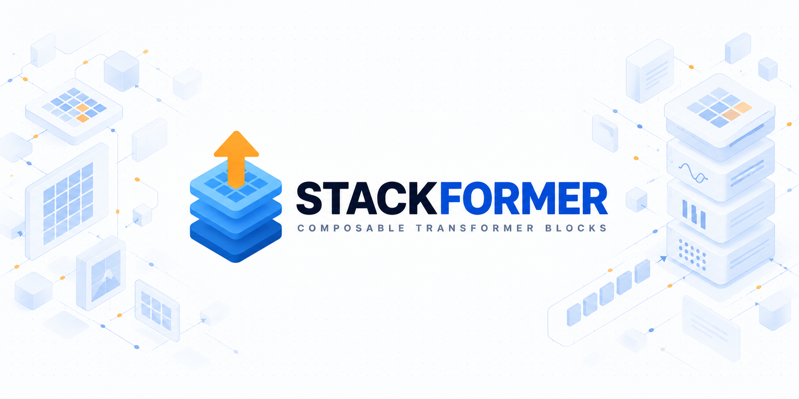
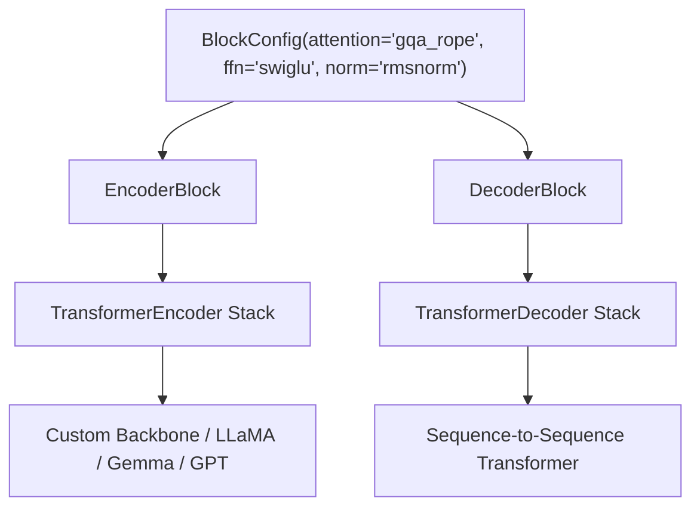
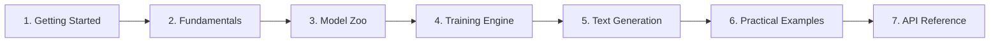

<div class="hero-container">
  <picture>
    <source media="(prefers-color-scheme: dark)" srcset="assets/logo-dark.png">
    
  </picture>
  <p class="hero-tagline">
    Composable PyTorch Transformer building blocks, modular architecture zoo, and lightweight training engine in a single clean library.
  </p>
  <div class="hero-badges">
    <a href="https://pypi.org/project/stackformer/"></a>
    <a href="https://pypi.org/project/stackformer/"></a>
    <a href="https://github.com/stackformer-labs/Stackformer/blob/main/LICENSE"></a>
    <a href="https://github.com/stackformer-labs/Stackformer/actions"></a>
  </div>
  <div class="hero-buttons">
    <a href="getting-started/quickstart/" class="hero-btn-primary">Get Started in 5 Minutes &rarr;</a>
    <a href="fundamentals/block-composition/" class="hero-btn-secondary">Explore BlockConfig</a>
    <a href="https://github.com/stackformer-labs/Stackformer" class="hero-btn-secondary">GitHub Repository</a>
  </div>
</div>

---

## Why StackFormer?

Building custom Transformer architectures today usually forces a frustrating choice: either fork thousands of lines of monolithic, copy-pasted model code from single-file repositories, or navigate bloated multi-layer abstraction frameworks designed primarily for pretrained weight hubs.

**StackFormer** provides a third way: **orthogonal, composable PyTorch primitives** that allow researchers and engineers to assemble custom vision and language Transformers declaratively via `BlockConfig`. Instead of rewriting multi-head attention, rotary positional embeddings, SwiGLU feed-forward networks, or pre-norm connections for every experiment, StackFormer exposes modular components that compose cleanly and execute directly on the pure PyTorch runtime.



---

## Core Capabilities

<div class="grid-cards">
  <div class="card-item">
    <h3>Declarative BlockConfig</h3>
    <p>Configure attention (MHA, GQA, MQA, RoPE), FFNs (GELU, SwiGLU, GeGLU), and norms (LayerNorm, RMSNorm) in a single typed dataclass.</p>
    <a href="fundamentals/block-composition/">Learn block composition &rarr;</a>
  </div>
  <div class="card-item">
    <h3>Architecture Zoo</h3>
    <p>Production-faithful implementations of GPT-1/2, LLaMA-1/2, Gemma-1, BERT, RoBERTa, Vaswani Transformer, ViT, and SegFormer-B0.</p>
    <a href="models/">Explore model zoo &rarr;</a>
  </div>
  <div class="card-item">
    <h3>Built-in Trainer Engine</h3>
    <p>High-level <code>Trainer</code> featuring Automatic Mixed Precision (AMP), DistributedDataParallel (DDP), gradient accumulation, and SafeTensors.</p>
    <a href="training/trainer/">Read training guide &rarr;</a>
  </div>
  <div class="card-item">
    <h3>Stateful KV-Cache Decoding</h3>
    <p>Fast autoregressive sequence generation with <code>text_generate()</code> and standardized <code>prefill()</code> and <code>decode()</code> contracts.</p>
    <a href="generation/text-generation/">Explore text generation &rarr;</a>
  </div>
  <div class="card-item">
    <h3>Pure PyTorch Foundation</h3>
    <p>Zero C++ compilation friction. Executes natively on PyTorch <code>nn.Module</code> and <code>F.scaled_dot_product_attention</code> with 153 passing tests.</p>
    <a href="developer-guide/architecture/">View architecture specs &rarr;</a>
  </div>
  <div class="card-item">
    <h3>SafeTensors & DCP</h3>
    <p>Export consolidated zero-dependency <code>.safetensors</code> weights or utilize PyTorch Distributed Checkpoint (DCP) for sharded states.</p>
    <a href="training/checkpointing/">Check checkpointing docs &rarr;</a>
  </div>
</div>

---

## Quick Example: Assemble a Custom Transformer in 10 Lines

```python
import torch
from stackformer.modules import BlockConfig, TransformerEncoder

# 1. Define modular layer configuration
config = BlockConfig(
    embed_dim=512,
    num_heads=8,
    hidden_dim=2048,
    attention="gqa_rope",  # Grouped-Query Attention with Rotary Embeddings
    num_kv_heads=2,        # 4 queries per key/value head
    ffn="swiglu",          # SwiGLU Feed-Forward Network
    norm="rmsnorm",        # RMSNorm pre-normalization
    pre_norm=True,
    dropout=0.1,
)

# 2. Instantiate a 6-layer Encoder backbone
encoder = TransformerEncoder(config, num_layers=6)

# 3. Execute forward pass with causal masking
x = torch.randn(2, 64, 512)
output = encoder(x, mask=True)
print("Encoder output shape:", output.shape)  # torch.Size([2, 64, 512])
```

---

## Supported Model Architecture Zoo

StackFormer ships canonical language and vision architectures implemented directly with reusable `stackformer.modules`:

| Model Architecture | Modality / Task | Attention Variant | Positional Embedding | Normalization | FFN Activation |
| :--- | :--- | :--- | :--- | :--- | :--- |
| [**GPT-1**](models/gpt.md) | Causal LM | MHA (Causal) | Absolute Learned | Post-LayerNorm | GELU |
| [**GPT-2**](models/gpt.md) | Causal LM | MHA (Causal) | Absolute Learned | Pre-LayerNorm | GELU |
| [**LLaMA-1**](models/llama.md) | Causal LM | MHA + RoPE | RoPE | Pre-RMSNorm | SwiGLU |
| [**LLaMA-2**](models/llama.md) | Causal LM | GQA + RoPE | RoPE | Pre-RMSNorm | SwiGLU |
| [**Gemma-1 (2B / 7B)**](models/gemma.md) | Causal LM | MQA / GQA + RoPE | RoPE | Pre-RMSNorm | GeGLU |
| [**BERT**](models/bert.md) | Masked LM / Encoder | MHA (Bidirectional) | Absolute Learned + Segment | Post-LayerNorm | GELU |
| [**RoBERTa**](models/roberta.md) | Masked LM / Encoder | MHA (Bidirectional) | Absolute Learned (Offset) | Post-LayerNorm | GELU |
| [**Vaswani Transformer**](models/transformer.md) | Seq2Seq Enc-Dec | MHA + Cross-MHA | Sinusoidal Fixed | Post-LayerNorm | ReLU |
| [**ViT**](models/vit.md) | Vision Classification | MHA (Bidirectional) | Absolute Learned | Pre-LayerNorm | GELU |
| [**SegFormer-B0**](models/segformer.md) | Semantic Segmentation | Spatial Reduction Attn | Mix-FFN (Conv-embedded) | Pre-LayerNorm | GELU |

---

## Installation

Install StackFormer directly from PyPI:

```bash
pip install stackformer
```

Or install from source with development and testing dependencies:

```bash
git clone https://github.com/stackformer-labs/Stackformer.git
cd Stackformer
pip install -e ".[dev]"
```

For full setup instructions, see the [Installation Guide](getting-started/installation.md).

---

## Documentation Roadmap



- **[Getting Started](getting-started/index.md)**: Installation instructions, quickstart walkthrough, first Transformer tutorial, and configuration guides.
- **[Fundamentals](fundamentals/index.md)**: Deep dive into `BlockConfig`, attention mechanisms, positional embeddings, normalization, and feed-forward networks.
- **[Model Zoo](models/index.md)**: Detailed architectural descriptions, tensor shapes, and code examples for each implemented model.
- **[Training Engine](training/index.md)**: Complete guide to `Trainer`, `Engine`, mixed precision (AMP), distributed data parallel (DDP), and SafeTensors checkpointing.
- **[Generation](generation/index.md)**: Autoregressive decoding, stateful KV caching, `prefill()` and `decode()` contracts, and sampling strategies.
- **[API Reference](api-reference/index.md)**: Autogenerated docstrings, function signatures, parameter descriptions, and return types.
- **[Examples](examples/index.md)**: Self-contained, runnable Python code examples.
- **[Developer Guide](developer-guide/index.md)**: Software architecture specifications, design non-goals, testing setup, and contributing standards.
