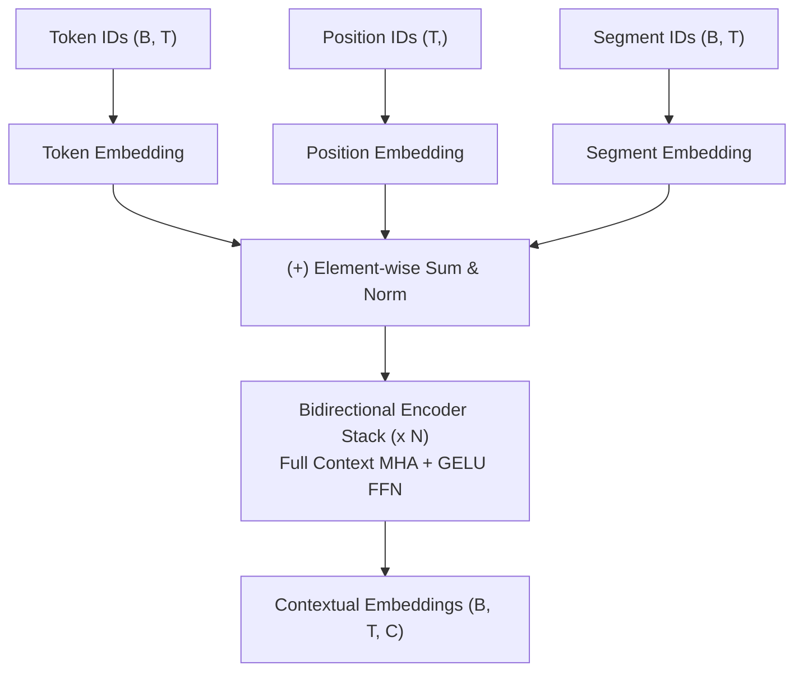

# BERT Architecture

StackFormer provides a native implementation of Google's **BERT** (Bidirectional Encoder Representations from Transformers) language representation model (Devlin et al., 2018).

Implemented in `stackformer.models.bert` and exposed at the top level as `BERT`.

---

## 1. Architecture Overview

Unlike autoregressive models (like GPT or LLaMA) which mask future tokens, BERT is a **bidirectional encoder**. Every token in the sequence attends freely to both left and right context simultaneously.

The architecture consists of:
1. **Tri-Part Embeddings**: Computes the element-wise sum of:
   - Token Embeddings: Discrete wordpiece token lookup.
   - Position Embeddings: Absolute learned positional representation ($0 \dots T-1$).
   - Segment Embeddings: Sentence pair segment indicator (Sentence A vs Sentence B, `token_type_ids`).
2. **Bidirectional Transformer Encoder Stack**: Stack of `EncoderBlock` layers with Post-LayerNorm, standard Multi-Head Attention (`mask=False`), and GELU feed-forward networks.
3. **Representation Outputs**: Emits sequence representations suitable for masked language modeling, sentence pair classification, or token-level sequence labeling.



---

## 2. Constructor Parameters

```python
BERT(
    vocab_size: int,
    num_layers: int,
    embed_dim: int,
    num_heads: int,
    seq_len: int,
    dropout: float = 0.1,
    hidden_dim: int = 0,
    num_segments: int = 2,
    qkv_bias: bool = True,
    eps: float = 1e-5,
    device: torch.device | str = "cpu",
    dtype: torch.dtype = torch.float32,
)
```

- `num_segments` (int, default=2): Number of distinct sentence segment IDs supported (0 for single sentence or Sentence A, 1 for Sentence B).
- `hidden_dim` (int, default=0): Inner dimension of FFN. Defaults to $4 \times \text{embed\_dim}$ when `0`.

---

## 3. Initialization & Forward Pass

### Shapes
- **Input `input_ids`**: Integer tensor of shape `(Batch, Sequence)` where values $\in [0, \text{vocab\_size}-1]$.
- **Input `token_type_ids`** (optional): Integer tensor of shape `(Batch, Sequence)` where values $\in [0, \text{num\_segments}-1]$. Defaults to all zeros if omitted.
- **Output `features`**: Contextual token feature representations of shape `(Batch, Sequence, EmbedDim)`.

```python
import torch
from stackformer.models import BERT

# 1. Instantiate BERT model
bert = BERT(
    vocab_size=30522,
    num_layers=6,
    embed_dim=256,
    num_heads=4,
    seq_len=128,
)

# 2. Input tokens: Batch=2, Sequence=16
input_ids = torch.randint(0, 30522, (2, 16))
token_type_ids = torch.zeros(2, 16, dtype=torch.long)

# 3. Compute bidirectional representations
features = bert(input_ids, token_type_ids=token_type_ids)
print("BERT features shape:", features.shape)  # torch.Size([2, 16, 256])
```

---

## 4. Fine-Tuning Example for Sequence Classification

```python
import torch
import torch.nn as nn
from stackformer.models import BERT

class BertClassifier(nn.Module):
    def __init__(self, num_classes: int = 2):
        super().__init__()
        self.bert = BERT(vocab_size=10000, num_layers=4, embed_dim=256, num_heads=4, seq_len=64)
        self.classifier = nn.Linear(256, num_classes)

    def forward(self, input_ids: torch.Tensor, token_type_ids: torch.Tensor | None = None) -> torch.Tensor:
        # 1. Extract contextual sequence features
        features = self.bert(input_ids, token_type_ids=token_type_ids)
        
        # 2. Extract [CLS] token representation at position 0
        cls_rep = features[:, 0, :]
        
        # 3. Project to classification logits
        return self.classifier(cls_rep)

model = BertClassifier(num_classes=2)
x = torch.randint(0, 10000, (4, 32))
logits = model(x)
print("Classification logits shape:", logits.shape)  # torch.Size([4, 2])
```

---

## 5. Implementation Limitations

1. **Non-Generative**: BERT is inherently bidirectional. It cannot be used directly with `text_generate()` because causal masking is not enforced.
2. **Context Length Cap**: Absolute position embedding size is fixed by `seq_len`. Sequences longer than `seq_len` must be truncated.

