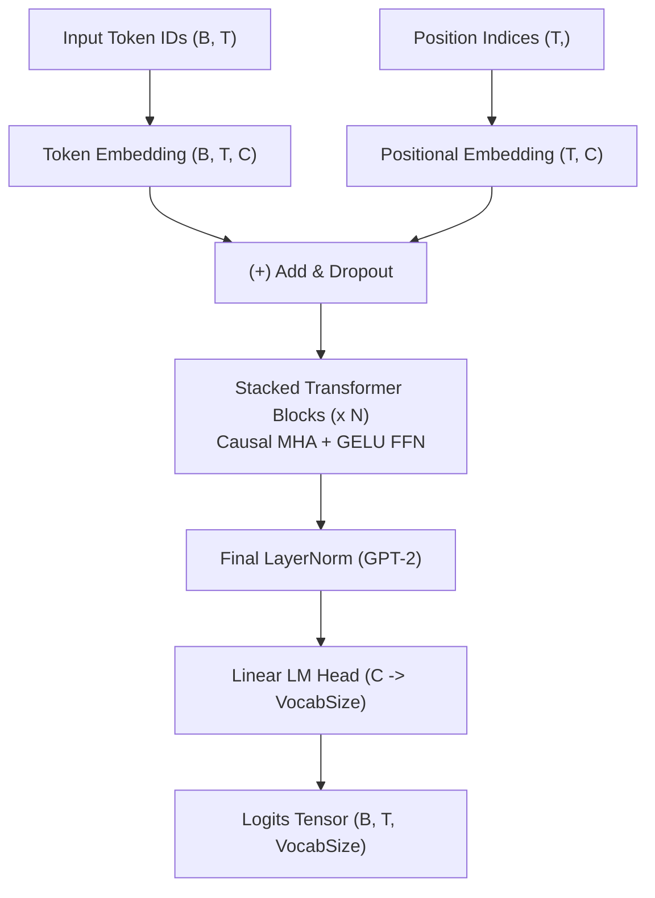

# GPT-1 & GPT-2 Architectures

StackFormer provides clean, canonical implementations of OpenAI's **GPT-1** and **GPT-2** autoregressive causal language models.

Implemented in `stackformer.models.gpt` and exposed at the top level as `GPT1`, `GPT2`, `GPT_1`, and `GPT_2`.

---

## 1. Architecture Overview

GPT-1 (Radford et al., 2018) and GPT-2 (Radford et al., 2019) are decoder-only Transformer architectures trained to predict the next token in a sequence given preceding context tokens.

The model consists of:
1. **Token & Learned Positional Embeddings**: Sum of discrete token embedding and learned absolute positional embedding table.
2. **Causal Transformer Block Stack**: Multiple stacked self-attention and feed-forward layers with lower-triangular causal masking to prevent future token leakage.
3. **Language Modeling Projection Head**: Final linear projection mapping hidden states to vocabulary logits $\mathbb{R}^{B \times T \times V}$.



---

## 2. Key Differences: GPT-1 vs GPT-2

| Architectural Feature | GPT-1 (`GPT1`) | GPT-2 (`GPT2`) |
| :--- | :--- | :--- |
| **Layer Normalization Placement** | **Post-LN**: Normalization placed *after* residual addition (`pre_norm=False`). | **Pre-LN**: Normalization placed *before* sub-layers (`pre_norm=True`). |
| **Final Normalization Layer** | No final norm layer before head. | Adds an extra `LayerNorm` after the final self-attention block before `lm_head`. |
| **Training Stability** | Requires strict learning rate warm-up to prevent gradient instability. | Extremely stable across deep configurations ($N=12, 24, 36, 48$). |
| **Initialization Scaling** | Standard Gaussian initialization. | Scales residual projection weights by $\frac{1}{\sqrt{2 N}}$ where $N$ is layer count. |

---

## 3. Constructor Parameters

```python
GPT2(
    vocab_size: int,
    num_layers: int,
    embed_dim: int,
    num_heads: int,
    seq_len: int,
    dropout: float = 0.1,
    hidden_dim: int = 0,
    qkv_bias: bool = True,
    eps: float = 1e-5,
    device: torch.device | str = "cpu",
    dtype: torch.dtype = torch.float32,
)
```

- `vocab_size` (int): Number of tokens in vocabulary (e.g. 50,257 for GPT-2 standard tokenizer).
- `num_layers` (int): Number of Transformer blocks ($N$).
- `embed_dim` (int): Hidden representation size ($C$). Must be divisible by `num_heads`.
- `num_heads` (int): Number of attention query heads ($H$).
- `seq_len` (int): Maximum sequence context window length ($T$).
- `dropout` (float, default=0.1): Dropout probability applied to embeddings, attention, and FFNs.
- `hidden_dim` (int, default=0): Inner dimension of FFN. When `0`, defaults to $4 \times \text{embed\_dim}$.
- `qkv_bias` (bool, default=True): Include bias term in Q, K, V linear projections.
- `eps` (float, default=1e-5): Epsilon for `LayerNorm`.

---

## 4. Initialization & Forward Pass

### Shapes
- **Input `input_ids`**: Integer tensor of shape `(Batch, Sequence)` where values are in $[0, \text{vocab\_size}-1]$. Sequence length $T \le \text{seq\_len}$.
- **Output `logits`**: Floating point tensor of shape `(Batch, Sequence, VocabSize)`.

```python
import torch
from stackformer.models import GPT2

# 1. Instantiate a 4-layer GPT-2 model
model = GPT2(
    vocab_size=50257,
    num_layers=4,
    embed_dim=256,
    num_heads=4,
    seq_len=128,
)

# 2. Input batch: Batch=2, Length=16
input_ids = torch.randint(0, 50257, (2, 16))

# 3. Compute logits
logits = model(input_ids)
print("Logits shape:", logits.shape)  # torch.Size([2, 16, 50257])
```

---

## 5. Training Example with `Trainer`

```python
import torch
from torch.utils.data import DataLoader, TensorDataset
from stackformer.engine import Trainer
from stackformer.models import GPT2

# 1. Create token data and shift-by-one targets for next-token prediction
x = torch.randint(0, 1000, (64, 16))
y = torch.randint(0, 1000, (64, 16))
loader = DataLoader(TensorDataset(x, y), batch_size=8)

# 2. Initialize model
model = GPT2(vocab_size=1000, num_layers=2, embed_dim=128, num_heads=4, seq_len=32)

# 3. Configure Trainer
trainer = Trainer(
    model=model,
    train_dataloader=loader,
    device="cpu",
    max_epochs=2,
    lr=3e-4,
    checkpoint_dir="checkpoints/gpt2_training",
)
trainer.fit()
```

---

## 6. Implementation Limitations

1. **Context Window Cap**: Uses `AbsolutePositionEmbedding`, strictly limiting inference to sequences $\le \text{seq\_len}$. Prompts longer than `seq_len` raise index out of bounds.
2. **Pretrained Checkpoint Conversion**: StackFormer provides the pure architecture implementation; weights must be trained from scratch or converted from external Safetensors dictionaries.

