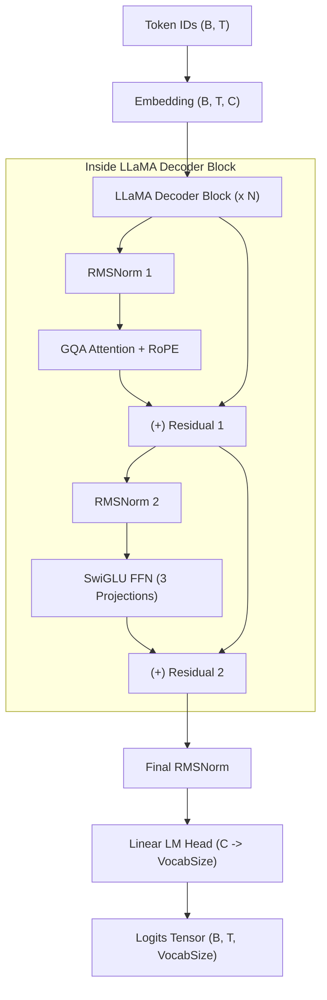

# LLaMA-1 & LLaMA-2 Architectures

StackFormer provides native implementations of Meta's **LLaMA-1** (Touvron et al., Feb 2023) and **LLaMA-2** (Touvron et al., Jul 2023) foundational language models.

Implemented in `stackformer.models.llama` and exposed at the top level as `Llama1`, `Llama2`, `Llama_1`, `Llama_2`, `llama_1`, and `llama_2`.

---

## 1. Architecture Overview

LLaMA models represent the modern standard for autoregressive language model backbones, introducing three core architectural shifts over traditional GPT designs:

1. **Pre-RMSNorm**: Replaces standard LayerNorm with Root Mean Square Normalization (`RMSNorm`), accelerating per-token forward/backward steps without mean-centering overhead.
2. **SwiGLU Activation**: Replaces standard GELU MLPs with 3-projection SwiGLU Gated Linear Units, providing richer non-linear capacity.
3. **Rotary Position Embeddings (RoPE)**: Replaces absolute position embeddings with rotary embeddings computed inside the attention mechanism, allowing smooth relative position distance modeling.
4. **Grouped-Query Attention (LLaMA-2)**: Clusters query heads to share a smaller number of Key/Value heads, reducing KV cache memory consumption during decoding by up to 75%.



---

## 2. Key Differences: LLaMA-1 vs LLaMA-2

| Architectural Feature | LLaMA-1 (`Llama1`) | LLaMA-2 (`Llama2`) |
| :--- | :--- | :--- |
| **Attention Architecture** | **Multi-Head Attention (MHA)** with RoPE | **Grouped-Query Attention (GQA)** with RoPE |
| **Key/Value Projections** | $H_{KV} = H_Q$ (equal query and KV heads) | $H_{KV} < H_Q$ (e.g. 8 query heads, 2 KV heads) |
| **KV Cache Footprint** | Standard MHA memory consumption | Reduced memory footprint (4x reduction with 4 queries/KV) |
| **Decoding Contract** | Standard forward sequence decoding | Stateful KV-cache accelerated generation |

---

## 3. Constructor Parameters

### `Llama1`

```python
Llama1(
    vocab_size: int,
    num_layers: int,
    embed_dim: int,
    num_heads: int,
    seq_len: int,
    dropout: float = 0.0,
    hidden_dim: int = 0,
    eps: float = 1e-5,
    device: torch.device | str = "cpu",
    dtype: torch.dtype = torch.float32,
)
```

### `Llama2`

```python
Llama2(
    vocab_size: int,
    num_layers: int,
    embed_dim: int,
    num_query_heads: int,
    num_kv_heads: int,
    seq_len: int = 2048,
    hidden_dim: int = 0,
    dropout: float = 0.0,
    eps: float = 1e-5,
    dtype: torch.dtype = torch.float32,
    device: torch.device | str = "cpu",
)
```

- `num_query_heads` (int): Number of Query attention heads.
- `num_kv_heads` (int): Number of Key/Value attention heads. `num_query_heads % num_kv_heads == 0`.
- `hidden_dim` (int, default=0): SwiGLU inner dimension. When `0`, defaults to $4 \times \text{embed\_dim}$.

---

## 4. Initialization & Forward Pass

### Shapes
- **Input `input_ids`**: Integer token tensor of shape `(Batch, Sequence)` where values $\in [0, \text{vocab\_size}-1]$.
- **Output `logits`**: Floating point tensor of shape `(Batch, Sequence, VocabSize)`.

```python
import torch
from stackformer.models import Llama2

# 1. Instantiate a compact LLaMA-2 model
model = Llama2(
    vocab_size=32000,
    num_layers=4,
    embed_dim=512,
    num_query_heads=8,
    num_kv_heads=2,
    seq_len=256,
)

# 2. Input tokens: Batch=1, Length=16
input_ids = torch.randint(0, 32000, (1, 16))

# 3. Compute logits
logits = model(input_ids)
print("LLaMA-2 logits shape:", logits.shape)  # torch.Size([1, 16, 32000])
```

---

## 5. Training with `Trainer`

```python
import torch
from torch.utils.data import DataLoader, TensorDataset
from stackformer.engine import Trainer
from stackformer.models import Llama2

# Prepare synthetic dataset
inputs = torch.randint(0, 32000, (64, 16))
targets = torch.randint(0, 32000, (64, 16))
loader = DataLoader(TensorDataset(inputs, targets), batch_size=8)

# Initialize model
model = Llama2(
    vocab_size=32000,
    num_layers=2,
    embed_dim=256,
    num_query_heads=4,
    num_kv_heads=2,
    seq_len=64,
)

# Train with Trainer
trainer = Trainer(
    model=model,
    train_dataloader=loader,
    device="cpu",
    max_epochs=1,
    max_train_steps=5,
    lr=3e-4,
    checkpoint_dir="checkpoints/llama2_run",
)
trainer.fit()
```

---

## 6. Implementation Limitations

1. **Weight Distribution**: StackFormer defines the architecture. Checkpoint weights must be trained natively or loaded from compatible SafeTensors files.
2. **Head Ratio Constraint**: `num_query_heads` must be an exact multiple of `num_kv_heads`.

