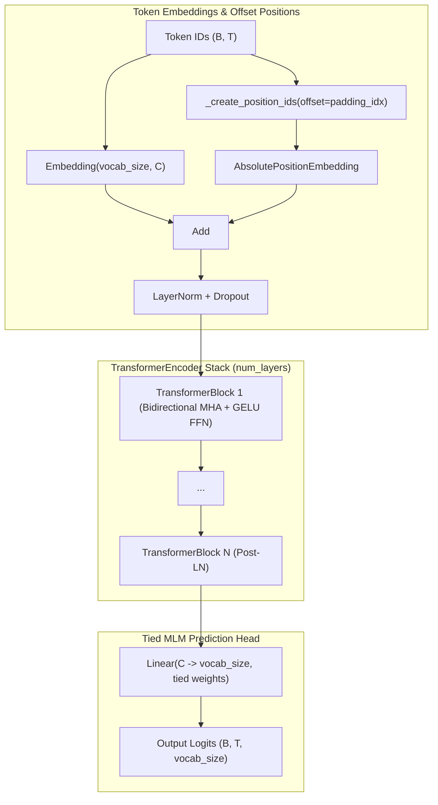

# RoBERTa

RoBERTa (**R**obustly **O**ptimized **BERT** Pretraining **A**pproach) is an encoder-only Transformer architecture developed by Meta AI (Liu et al., 2019). It optimizes the original BERT pretraining recipe by removing the Next Sentence Prediction (NSP) task, training on larger batch sizes with longer sequences over larger corpora, and applying dynamic masking.

In StackFormer, `RoBERTa` is implemented using composable `TransformerEncoder` blocks configured with bidirectional Multi-Head Attention (MHA), Post-LayerNorm, GELU feed-forward networks, and Fairseq-style offset position embeddings.

---

## Key Architectural Characteristics

| Characteristic | RoBERTa Specification |
| :--- | :--- |
| **Model Type** | Encoder-Only (Bidirectional) |
| **Masking** | Padding mask only (no causal masking) |
| **Attention Variant** | Multi-Head Attention (`mha`) |
| **FFN Activation** | GELU |
| **Normalization** | Post-LayerNorm (`pre_norm=False`) |
| **Position Embeddings** | Learned absolute embeddings with `padding_idx` offset |
| **Token Types / Segments**| None (removed NSP objective) |
| **Output Head** | Linear MLM head tied to token embeddings |

---

## Architecture Diagram



---

## Fairseq-Style Offset Position Embeddings

RoBERTa uses an offset indexing scheme inherited from Fairseq where position indices start at `padding_idx + 1` for valid tokens, avoiding collision with padding tokens (`padding_idx=1` by default):

$$\text{position\_ids} = (\text{mask}.\text{cumsum}(-1) + \text{padding\_idx}) \cdot \text{mask} + \text{padding\_idx} \cdot (1 - \text{mask})$$

StackFormer implements this directly inside the `_create_position_ids` method:

```python
def _create_position_ids(self, input_ids: torch.Tensor) -> torch.Tensor:
    mask = input_ids.ne(self.padding_idx).int()
    return (mask.cumsum(dim=-1) + self.padding_idx) * mask + self.padding_idx * (1 - mask)
```

---

## Constructor Parameters

```python
from stackformer.models import RoBERTa

model = RoBERTa(
    vocab_size=50265,
    num_layers=12,
    embed_dim=768,
    num_heads=12,
    seq_len=512,
    dropout=0.1,
    hidden_dim=0,         # 0 defaults to 4 * embed_dim (3072)
    padding_idx=1,        # Padding token ID for position offset
    qkv_bias=True,
    eps=1e-5,
    device="cpu",
    dtype=torch.float32,
)
```

| Parameter | Type | Default | Description |
| :--- | :--- | :--- | :--- |
| `vocab_size` | `int` | *required* | Total size of token vocabulary (typically `50265` for RoBERTa BPE). |
| `num_layers` | `int` | *required* | Number of encoder blocks. |
| `embed_dim` | `int` | *required* | Model hidden embedding dimension $d_{\text{model}}$. Must be divisible by `num_heads`. |
| `num_heads` | `int` | *required* | Number of attention heads. |
| `seq_len` | `int` | *required* | Maximum sequence context length. |
| `dropout` | `float` | `0.1` | Dropout probability applied across embeddings and attention. |
| `hidden_dim` | `int` | `0` | Intermediate dimension for feed-forward network. If `0`, defaults to `4 * embed_dim`. |
| `padding_idx` | `int` | `1` | Special padding token ID used for offset position encoding. |
| `qkv_bias` | `bool` | `True` | Enable bias terms in linear projections ($W_q, W_k, W_v, W_o$). |
| `eps` | `float` | `1e-5` | Small epsilon value for numerical stability in LayerNorm. |
| `device` | `torch.device \| str` | `"cpu"` | Target compute device. |
| `dtype` | `torch.dtype` | `torch.float32` | Weight tensor data type. |

---

## Basic Usage

### Forward Pass (Masked Language Modeling)

```python
import torch
from stackformer.models import RoBERTa

# Initialize RoBERTa-base equivalent
model = RoBERTa(
    vocab_size=50265,
    num_layers=12,
    embed_dim=768,
    num_heads=12,
    seq_len=512,
)

# Input token IDs: batch of 2 sequences, length 128
input_ids = torch.randint(2, 50265, (2, 128))

# Forward pass computes logits across vocabulary for all positions
logits = model(input_ids)
print("Logits shape:", logits.shape)  # torch.Size([2, 128, 50265])
```

### Pretraining / Fine-Tuning Step with Cross-Entropy

```python
import torch
import torch.nn as nn
from stackformer.models import RoBERTa

device = "cuda" if torch.cuda.is_available() else "cpu"
model = RoBERTa(vocab_size=50265, num_layers=6, embed_dim=384, num_heads=6, seq_len=256, device=device)
optimizer = torch.optim.AdamW(model.parameters(), lr=1e-4)
criterion = nn.CrossEntropyLoss(ignore_index=1)  # Ignore padding_idx=1

# Mock batch: input_ids and targets
batch_size, seq_len = 4, 128
input_ids = torch.randint(2, 50265, (batch_size, seq_len), device=device)
targets = input_ids.clone()

# Mask 15% of tokens with mask token ID (e.g. 50264)
mask_indices = torch.rand(batch_size, seq_len, device=device) < 0.15
input_ids[mask_indices] = 50264

# Training step
optimizer.zero_grad()
logits = model(input_ids)
loss = criterion(logits.view(-1, 50265), targets.view(-1))
loss.backward()
optimizer.step()

print(f"MLM Loss: {loss.item():.4f}")
```

---

## RoBERTa vs BERT Comparison

| Feature | Original BERT | StackFormer RoBERTa |
| :--- | :--- | :--- |
| **Pretraining Tasks** | MLM + Next Sentence Prediction (NSP) | MLM only (NSP eliminated) |
| **Segment Embeddings** | Yes (`token_type_ids`) | No |
| **Positional Offset** | Absolute positions starting at `0` | Offset positions starting at `padding_idx + 1` |
| **Masking Strategy** | Static pre-computed masking | Dynamic runtime masking |
| **Vocabulary Size** | 30,522 (WordPiece) | 50,265 (Byte-level BPE) |

