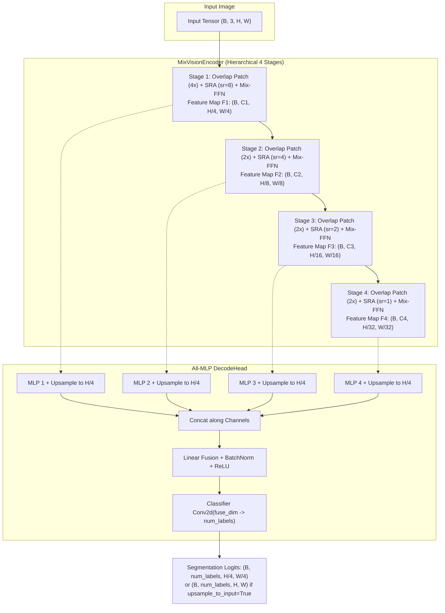

# SegFormer

SegFormer is a hierarchical Transformer architecture designed specifically for efficient semantic segmentation, introduced by Xie et al. in *SegFormer: Simple and Efficient Design for Semantic Segmentation with Transformers* (NeurIPS 2021).

Unlike standard Vision Transformers that output single-scale low-resolution feature maps and require positional embeddings, SegFormer introduces:
1. **Hierarchical Mix Vision Transformer (MiT)**: Outputs multiscale features at $\frac{1}{4}$, $\frac{1}{8}$, $\frac{1}{16}$, and $\frac{1}{32}$ of original image resolution.
2. **Positional-Encoding-Free Design**: Replaces fixed or learned position embeddings with a $3 \times 3$ depthwise convolution inside the feed-forward network (Mix-FFN).
3. **Spatial Reduction Attention (SRA)**: Downsamples Key and Value sequence lengths, reducing quadratic attention complexity to manageable bounds on high-resolution inputs.
4. **Lightweight All-MLP Decoder**: Avoids heavy dilated convolutions or complex feature pyramid networks by simply aggregating multi-level features via MLPs.

In StackFormer, SegFormer is available in `stackformer.vision` as `SegFormer` (or `StackFormerSegformer`).

---

## Architectural Stages



---

## Spatial Reduction Attention (SRA)

Standard self-attention computes dot products over sequence length $N = H \times W$:

$$\mathcal{O}(N^2) = \mathcal{O}((HW)^2)$$

For a $512 \times 512$ image, $N = 16384$ in stage 1, making full attention intractable. SRA reduces the spatial dimensions of Keys and Values using a spatial reduction ratio $R$:

$$\mathbf{K}' = \text{LayerNorm}(\text{Conv2d}(\mathbf{K}, \text{kernel}=R, \text{stride}=R))$$
$$\mathbf{V}' = \text{LayerNorm}(\text{Conv2d}(\mathbf{V}, \text{kernel}=R, \text{stride}=R))$$

StackFormer implements this via `SequenceReduction`:

```python
class SequenceReduction(nn.Module):
    def __init__(self, hidden_size: int, sr_ratio: int) -> None:
        super().__init__()
        self.sequence_reduction = nn.Conv2d(
            hidden_size, hidden_size, kernel_size=sr_ratio, stride=sr_ratio
        )
        self.layer_norm = nn.LayerNorm(hidden_size)
```

The sequence reduction ratio decreases progressively across stages ($R = [8, 4, 2, 1]$), keeping compute balanced as spatial resolution decreases.

---

## Model Variants

StackFormer supports configurations `b0` through `b5`:

| Variant | Channel Dims $[C_1, C_2, C_3, C_4]$ | Depths $[L_1, L_2, L_3, L_4]$ | Decoder Dim | Description |
| :--- | :--- | :--- | :--- | :--- |
| **`b0`** | `[32, 64, 160, 256]` | `[2, 2, 2, 2]` | `256` | Ultra-lightweight edge model (~3.8M params) |
| **`b1`** | `[64, 128, 320, 512]` | `[2, 2, 2, 2]` | `768` | Lightweight general-purpose baseline |
| **`b2`** | `[64, 128, 320, 512]` | `[3, 4, 6, 3]` | `768` | Balanced accuracy and speed |
| **`b3`** | `[64, 128, 320, 512]` | `[3, 4, 18, 3]` | `768` | High capacity vision backbone |
| **`b4`** | `[64, 128, 320, 512]` | `[3, 8, 27, 3]` | `768` | Very deep configuration for large datasets |
| **`b5`** | `[64, 128, 320, 512]` | `[3, 6, 40, 3]` | `768` | Maximum capacity model |

---

## Constructor Parameters

```python
from stackformer.vision import SegFormer

model = SegFormer(
    variant="b0",
    num_labels=150,
    dropout=0.0,
)
```

| Parameter | Type | Default | Description |
| :--- | :--- | :--- | :--- |
| `variant` | `str` | `"b0"` | Model variant choice (`"b0"`, `"b1"`, `"b2"`, `"b3"`, `"b4"`, or `"b5"`). |
| `num_labels` | `int` | `150` | Number of semantic segmentation target classes (e.g., 150 for ADE20K, 19 for Cityscapes). |
| `dropout` | `float` | `0.0` | Encoder dropout probability. |

---

## Usage Examples

### Semantic Segmentation Forward Pass

```python
import torch
from stackformer.vision import SegFormer

# Initialize lightweight SegFormer-B0 for 19 classes (e.g., Cityscapes)
model = SegFormer(variant="b0", num_labels=19)

# Input image tensor: (Batch, Channels, Height, Width)
images = torch.randn(2, 3, 512, 512)

# Forward pass returning 1/4 resolution logits: (B, num_labels, H/4, W/4)
logits = model(images)
print("Standard logits shape:", logits.shape)  # torch.Size([2, 19, 128, 128])

# Forward pass with automatic bilinear upsampling to input resolution:
full_res_logits = model(images, upsample_to_input=True)
print("Upsampled logits shape:", full_res_logits.shape)  # torch.Size([2, 19, 512, 512])

# Compute pixel-level class predictions
predictions = torch.argmax(full_res_logits, dim=1)
print("Prediction mask shape:", predictions.shape)  # torch.Size([2, 512, 512])
```

### Extracting Hierarchical Features from the Encoder

You can use the encoder backbone (`MixVisionEncoder` / `Encoder`) directly to extract multi-scale representations for custom decoders or detection heads:

```python
from stackformer.vision.segformer import Encoder
import torch

encoder = Encoder(variant="b0")
images = torch.randn(2, 3, 512, 512)

# Returns 4 feature maps from stages 1 to 4
f1, f2, f3, f4 = encoder(images)

print("Stage 1 (1/4 res):", f1.shape)   # (2, 32, 128, 128)
print("Stage 2 (1/8 res):", f2.shape)   # (2, 64, 64, 64)
print("Stage 3 (1/16 res):", f3.shape)  # (2, 160, 32, 32)
print("Stage 4 (1/32 res):", f4.shape)  # (2, 256, 16, 16)
```

### Training Step with Pixel-Wise Cross-Entropy Loss

```python
import torch
import torch.nn as nn
from stackformer.vision import SegFormer

device = "cuda" if torch.cuda.is_available() else "cpu"
model = SegFormer(variant="b0", num_labels=19).to(device)
optimizer = torch.optim.AdamW(model.parameters(), lr=1e-4, weight_decay=1e-2)
criterion = nn.CrossEntropyLoss(ignore_index=255)

# Synthetic image batch and target pixel label mask
images = torch.randn(2, 3, 256, 256, device=device)
targets = torch.randint(0, 19, (2, 256, 256), device=device)

# Training step with upsampled logits
optimizer.zero_grad()
logits = model(images, upsample_to_input=True)
loss = criterion(logits, targets)
loss.backward()
optimizer.step()

print(f"SegFormer Segmentation Loss: {loss.item():.4f}")
```

