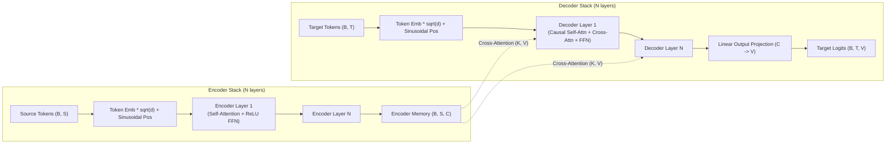

# Canonical Transformer (Vaswani et al.)

The canonical Transformer is the landmark sequence-to-sequence encoder-decoder architecture introduced by Vaswani et al. in *Attention Is All You Need* (2017). Designed for sequence transduction tasks like machine translation, document summarization, and question answering, it replaces recurrence and convolutions entirely with multi-head self-attention and cross-attention mechanisms.

In StackFormer, `Transformer` coordinates an encoder stack (`TransformerEncoder`) and a decoder stack (`TransformerDecoder`) constructed from reusable `BlockConfig` modules.

---

## Architectural Overview



### Encoder Mechanics
- **Bidirectional Self-Attention**: All source positions attend freely to all other source positions (`mask=False`).
- **Fixed Sinusoidal Positional Encoding**: Position vectors generated analytically from sine and cosine waves at geometric progression frequencies.
- **Post-LayerNorm Architecture**: Residual addition occurs before normalization ($x + \text{SubLayer}(x) \rightarrow \text{LayerNorm}$).

### Decoder Mechanics
- **Causal Self-Attention**: Masked with a triangular causal mask so target position $t$ can only attend to earlier tokens $1 \dots t$.
- **Cross-Attention (Encoder-Decoder Attention)**: Queries ($Q$) originate from the decoder representations, while Keys ($K$) and Values ($V$) originate from the final encoder representations (`memory`).
- **Autoregressive Generation**: Conditioned on both prior generated tokens and encoder context.

---

## Constructor Parameters

```python
from stackformer.models import Transformer

model = Transformer(
    vocab_size=32000,
    embed_dim=512,
    num_heads=8,
    dropout=0.1,
    hidden_dim=2048,
    encoder_layers=6,
    decoder_layers=6,
    seq_len=512,
    eps=1e-5,
    device="cpu",
    dtype=torch.float32,
)
```

| Parameter | Type | Default | Description |
| :--- | :--- | :--- | :--- |
| `vocab_size` | `int` | *required* | Total size of shared token vocabulary. |
| `embed_dim` | `int` | *required* | Hidden embedding dimension $d_{\text{model}}$. Must be divisible by `num_heads`. |
| `num_heads` | `int` | *required* | Number of attention heads in both encoder and decoder. |
| `dropout` | `float` | `0.1` | Dropout rate applied in attention and feed-forward layers. |
| `hidden_dim` | `int` | `0` | Inner FFN intermediate dimension. If `0`, defaults to `4 * embed_dim`. |
| `encoder_layers` | `int` | `6` | Number of stacked encoder layers. |
| `decoder_layers` | `int` | `6` | Number of stacked decoder layers. |
| `seq_len` | `int` | `512` | Maximum context length for sinusoidal positional embeddings. |
| `eps` | `float` | `1e-5` | Layer normalization numerical epsilon. |
| `device` | `torch.device \| str` | `"cpu"` | Compute device. |
| `dtype` | `torch.dtype` | `torch.float32` | Weights tensor data type. |

---

## Usage Examples

### Full Sequence-to-Sequence Forward Pass

```python
import torch
from stackformer.models import Transformer

# Initialize base Transformer
model = Transformer(
    vocab_size=32000,
    embed_dim=512,
    num_heads=8,
    encoder_layers=6,
    decoder_layers=6,
    seq_len=256,
)

# Source sequence: batch of 2, length 40
src = torch.randint(0, 32000, (2, 40))

# Target sequence (teacher forcing inputs): batch of 2, length 30
tgt = torch.randint(0, 32000, (2, 30))

# Compute target token logits
logits = model(src, tgt)
print("Output logits shape:", logits.shape)  # torch.Size([2, 30, 32000])
```

### Decoupled Encoding and Decoding

StackFormer explicitly exposes `.encode()` and `.decode()` methods for flexible generation workflows:

```python
# 1. Encode source text once
memory = model.encode(src)
print("Encoder memory shape:", memory.shape)  # torch.Size([2, 40, 512])

# 2. Decode candidate target tokens
dec_hidden = model.decode(tgt, memory)
print("Decoder hidden representations:", dec_hidden.shape)  # torch.Size([2, 30, 512])

# 3. Project to vocabulary logits
step_logits = model.out_proj(dec_hidden)
print("Logits shape:", step_logits.shape)  # torch.Size([2, 30, 32000])
```

### Autoregressive Greedy Decoding Loop

```python
import torch
from stackformer.models import Transformer

model = Transformer(vocab_size=1000, embed_dim=256, num_heads=4, encoder_layers=3, decoder_layers=3)
model.eval()

src = torch.randint(1, 1000, (1, 20))
BOS_TOKEN = 1
EOS_TOKEN = 2
max_new_tokens = 15

# Step 1: Compute encoder memory once
with torch.no_grad():
    memory = model.encode(src)

# Step 2: Initialize decoder tokens with BOS
generated = torch.tensor([[BOS_TOKEN]], dtype=torch.long)

# Step 3: Autoregressively generate tokens
with torch.no_grad():
    for _ in range(max_new_tokens):
        dec_out = model.decode(generated, memory)
        logits = model.out_proj(dec_out[:, -1:, :])  # Take last token
        next_token = torch.argmax(logits, dim=-1)
        generated = torch.cat([generated, next_token], dim=1)
        if next_token.item() == EOS_TOKEN:
            break

print("Generated token sequence:", generated[0].tolist())
```

