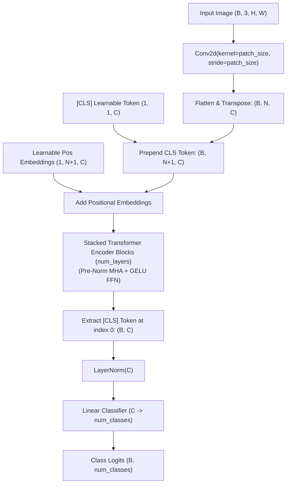

# Vision Transformer (ViT)

The Vision Transformer (ViT) architecture was introduced by Dosovitskiy et al. in *An Image is Worth 16x16 Words: Transformers for Image Recognition at Scale* (Google Research, ICLR 2021). ViT demonstrates that the standard Transformer architecture can be directly applied to computer vision tasks with minimal inductive bias, matching or outperforming state-of-the-art convolutional networks when pretrained at scale.

In StackFormer, `ViT` is implemented inside `stackformer.vision` with clean modular components: `PatchEmbedding`, `Block`, `Encoder`, and the `ViT` classification network.

---

## Architectural Workflow



### 1. Patch Projection
The 2D image $\mathbf{x} \in \mathbb{R}^{H \times W \times C}$ is partitioned into $N = \frac{HW}{P^2}$ non-overlapping patches of resolution $P \times P$. A 2D convolution with `kernel_size=P` and `stride=P` projects each patch into a $C$-dimensional vector space.

### 2. Learnable [CLS] Token and Positional Embeddings
A learnable classification token $\mathbf{x}_{\text{class}} \in \mathbb{R}^{1 \times 1 \times C}$ is prepended to the patch sequence, producing a sequence of length $N + 1$. Learnable 1D position embeddings $\mathbf{E}_{\text{pos}} \in \mathbb{R}^{1 \times (N+1) \times C}$ are added to retain spatial awareness:

$$\mathbf{z}_0 = [\mathbf{x}_{\text{class}}; \, \mathbf{x}_p^1\mathbf{E}; \, \dots; \, \mathbf{x}_p^N\mathbf{E}] + \mathbf{E}_{\text{pos}}$$

### 3. Pre-Norm Transformer Encoder
Each encoder block applies Pre-Norm Multi-Head Attention and GELU-based Feed-Forward Networks with residual connections:

$$\mathbf{z}'_\ell = \text{MHA}(\text{LayerNorm}(\mathbf{z}_{\ell-1})) + \mathbf{z}_{\ell-1}$$
$$\mathbf{z}_\ell = \text{FFN}(\text{LayerNorm}(\mathbf{z}'_\ell)) + \mathbf{z}'_\ell$$

### 4. Classification Head
The representation corresponding to the `[CLS]` token $\mathbf{z}_L^0$ is normalized with LayerNorm and projected to class probabilities with a linear layer.

---

## Constructor Parameters

```python
from stackformer.vision import ViT

model = ViT(
    img_size=224,
    patch_size=16,
    num_layers=12,
    embed_dim=768,
    num_classes=1000,
    num_heads=12,
    dropout=0.1,
    hidden_dim=3072,
    eps=1e-5,
    in_channels=3,
)
```

| Parameter | Type | Default | Description |
| :--- | :--- | :--- | :--- |
| `img_size` | `int` | `224` | Height and width of input square images ($H = W$). |
| `patch_size` | `int` | `16` | Spatial resolution of square image patches ($P$). Must evenly divide `img_size`. |
| `num_layers` | `int` | `12` | Depth of the Transformer encoder backbone. |
| `embed_dim` | `int` | `768` | Hidden token embedding dimension ($d_{\text{model}}$). Must be divisible by `num_heads`. |
| `num_classes` | `int` | `1000` | Number of target output classification categories. |
| `num_heads` | `int` | `12` | Number of parallel attention heads. |
| `dropout` | `float` | `0.1` | Dropout probability for attention and FFN layers. |
| `hidden_dim` | `int` | `3072` | Inner hidden dimension of the GELU feed-forward network ($4 \times d_{\text{model}}$). |
| `eps` | `float` | `1e-5` | Numerical stability epsilon for LayerNorm. |
| `in_channels` | `int` | `3` | Number of image color channels (3 for standard RGB). |

---

## Usage Examples

### Standard Image Classification

```python
import torch
from stackformer.vision import ViT

# Instantiate ViT-Base (patch 16, 224x224 input)
model = ViT(
    img_size=224,
    patch_size=16,
    num_layers=12,
    embed_dim=768,
    num_heads=12,
    num_classes=1000,
)

# Batch of 4 RGB images: (B, C, H, W)
images = torch.randn(4, 3, 224, 224)

# Predict class logits
logits = model(images)
print("Logits shape:", logits.shape)  # torch.Size([4, 1000])

# Top-1 predicted classes
predicted_classes = torch.argmax(logits, dim=-1)
print("Predicted classes:", predicted_classes)
```

### Inspecting Intermediate Patch Representations

You can also use lower-level vision modules like `PatchEmbedding` directly:

```python
from stackformer.vision.vit import PatchEmbedding

patch_embed = PatchEmbedding(img_size=224, patch_size=16, embed_dim=768, in_channels=3)
x = torch.randn(2, 3, 224, 224)

tokens = patch_embed(x)
print("Patch tokens shape:", tokens.shape)
# Shape: (2, 196, 768) where 196 = (224 / 16)^2
```

### Training Step with CrossEntropyLoss

```python
import torch
import torch.nn as nn
from stackformer.vision import ViT

device = "cuda" if torch.cuda.is_available() else "cpu"

model = ViT(
    img_size=64,
    patch_size=8,
    num_layers=4,
    embed_dim=256,
    num_heads=4,
    num_classes=10,
    device=device,
)
optimizer = torch.optim.AdamW(model.parameters(), lr=3e-4, weight_decay=0.05)
criterion = nn.CrossEntropyLoss()

# Synthetic mini-batch
images = torch.randn(8, 3, 64, 64, device=device)
labels = torch.randint(0, 10, (8,), device=device)

# Forward and backward
optimizer.zero_grad()
outputs = model(images)
loss = criterion(outputs, labels)
loss.backward()
optimizer.step()

print(f"ViT Training Loss: {loss.item():.4f}")
```

