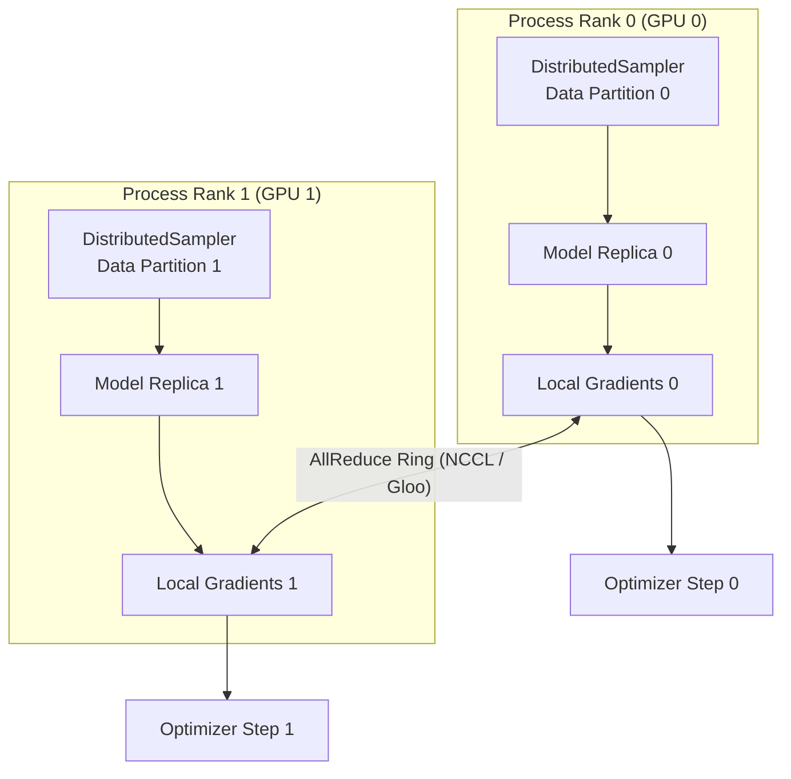

# Distributed Training (DDP)

StackFormer includes full, native support for multi-GPU and multi-node training using PyTorch's **DistributedDataParallel (DDP)** engine via the `stackformer.distributed` package.

---

## Distributed Architecture Overview

In DDP, each GPU process runs an identical copy of the model, processes an independent partition of data, computes gradients locally, and synchronizes gradients across all ranks using efficient ring-allreduce communications before taking an optimizer step.



---

## Distributed Utilities API

The `stackformer.distributed` module provides standard helper functions:

```python
from stackformer.distributed import (
    init_distributed,
    wrap_model_ddp,
    distributed_sampler,
    get_rank,
    get_world_size,
    get_local_rank,
    is_distributed,
    is_main_process,
    barrier,
    cleanup_distributed,
)
```

| Function | Return Type | Description |
| :--- | :--- | :--- |
| `init_distributed(backend=None)` | `torch.device` | Initializes the process group using environment variables (`RANK`, `WORLD_SIZE`, `LOCAL_RANK`). Selects `"nccl"` on CUDA or `"gloo"` on CPU/Windows. Sets the active CUDA device. |
| `wrap_model_ddp(model, ...)` | `DistributedDataParallel` | Wraps a model in PyTorch's DDP container, mapping to `local_rank` device ID. |
| `distributed_sampler(dataset)` | `DistributedSampler` | Partitions a dataset evenly across process ranks without data duplication. |
| `get_rank()` | `int` | Returns the global rank of the current process ($0 \dots \text{world\_size}-1$). |
| `get_world_size()` | `int` | Returns the total number of participating processes. |
| `get_local_rank()` | `int` | Returns the local GPU ID assigned to this process on the current node. |
| `is_main_process()` | `bool` | Returns `True` only on Rank 0 (used to guard file writes and console logs). |
| `barrier()` | `None` | Blocks until all participating processes in the group reach this point. |
| `cleanup_distributed()` | `None` | Destroys the process group cleanly upon training completion. |

---

## Distributed Training with `Trainer`

StackFormer's `Trainer` manages DDP initialization, model wrapping, and distributed sampler synchronization automatically:

```python
import os
import torch
from torch.utils.data import DataLoader, TensorDataset
from stackformer.models import Llama2
from stackformer.engine import Trainer

# 1. Setup mock dataset
dataset = TensorDataset(torch.randint(0, 32000, (1000, 128)))
train_loader = DataLoader(dataset, batch_size=4)

# 2. Instantiate Model
model = Llama2(
    vocab_size=32000,
    num_layers=8,
    embed_dim=512,
    num_query_heads=8,
    num_kv_heads=2,
    seq_len=128,
)

# 3. Configure Trainer with DDP
trainer = Trainer(
    model=model,
    train_dataloader=train_loader,
    max_epochs=3,
    use_ddp=True,             # Automatically detects process group and wraps model
    grad_accumulation_step=2,
    use_amp=True,
    checkpoint_dir="checkpoints/distributed_run",
)

trainer.fit()
```

---

## Launching with `torchrun`

Distributed jobs should be started using PyTorch's official `torchrun` launcher.

### Single Node, 4 GPUs

```bash
torchrun --standalone --nproc_per_node=4 train_script.py
```

### Multi-Node Setup (2 Nodes with 8 GPUs each)

On the primary master node (IP: `10.0.0.1`):
```bash
torchrun \
    --nproc_per_node=8 \
    --nnodes=2 \
    --node_rank=0 \
    --master_addr="10.0.0.1" \
    --master_port=29500 \
    train_script.py
```

On the secondary worker node:
```bash
torchrun \
    --nproc_per_node=8 \
    --nnodes=2 \
    --node_rank=1 \
    --master_addr="10.0.0.1" \
    --master_port=29500 \
    train_script.py
```

---

## Writing Custom DDP Loops

For scripts with custom distributed training loops:

```python
import torch
from torch.utils.data import DataLoader
from stackformer.distributed import (
    init_distributed,
    wrap_model_ddp,
    distributed_sampler,
    is_main_process,
    cleanup_distributed,
)
from stackformer.models import GPT2

# 1. Initialize process group
device = init_distributed()

# 2. Model & DDP wrapping
model = GPT2(vocab_size=1000, num_layers=4, embed_dim=256, num_heads=4, seq_len=64).to(device)
ddp_model = wrap_model_ddp(model, device_ids=[device.index])

# 3. Distributed sampler
dataset = ...
sampler = distributed_sampler(dataset, shuffle=True)
dataloader = DataLoader(dataset, batch_size=8, sampler=sampler)

# 4. Loop
optimizer = torch.optim.AdamW(ddp_model.parameters(), lr=1e-3)
for epoch in range(5):
    sampler.set_epoch(epoch)  # Crucial for unique epoch shuffles
    for batch in dataloader:
        optimizer.zero_grad()
        loss = ...
        loss.backward()
        optimizer.step()

    if is_main_process():
        print(f"Epoch {epoch} complete.")

# 5. Cleanup
cleanup_distributed()
```

