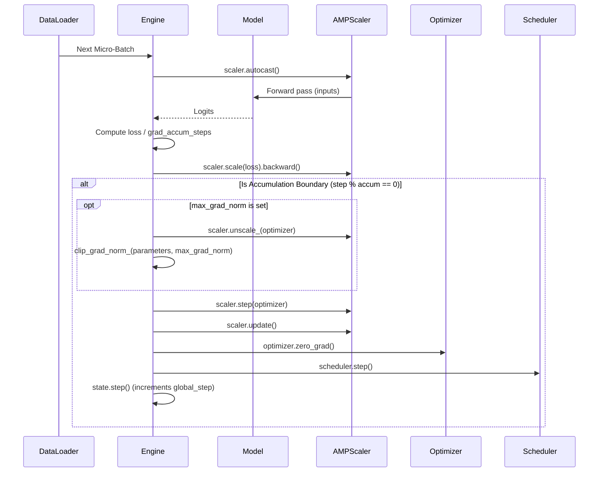

# Engine & State Management

StackFormer decouples high-level training loops from execution mechanics using two primary classes:
- **`TrainingState`**: A structured container bundling the mutable objects of a training run (model, optimizer, scheduler, gradient scaler, device, step counters).
- **`Engine`**: A runtime step executor that orchestrates micro-batch forward passes, loss calculation, backward propagation, gradient accumulation, gradient norm clipping, AMP scaling, and metric aggregation.

---

## Architecture of Step Execution



---

## `TrainingState`

`TrainingState` encapsulates all mutable execution state into a single dataclass-like container.

### Constructor Parameters

```python
from stackformer.engine import TrainingState

state = TrainingState(
    model=model,
    optimizer=optimizer,
    scheduler=scheduler,
    scaler=scaler,
    device="cuda",
    config={"lr": 1e-4, "batch_size": 32},
)
```

| Field | Type | Description |
| :--- | :--- | :--- |
| `model` | `nn.Module \| None` | Target PyTorch neural network. |
| `optimizer` | `Optimizer \| None` | Optimization algorithm instance. |
| `scheduler` | `LRScheduler \| None` | Learning rate schedule manager. |
| `scaler` | `AMPScaler \| GradScaler \| None` | Precision scaler for mixed-precision training. |
| `device` | `torch.device` | Active target compute device (`cpu` or `cuda:X`). |
| `epoch` | `int` | Current epoch index (starts at `0`). |
| `global_step` | `int` | Total number of optimizer update steps executed. |
| `config` | `dict \| None` | Arbitrary configuration or hyperparameter metadata. |

### Tracking Steps

```python
state.step()        # Increments global_step by 1
state.epoch += 1    # Advance epoch counter
```

---

## `Engine`

`Engine` executes step-level operations across batches and tracks runtime statistics using `MetricTracker`.

### Constructor Parameters

```python
from stackformer.engine import Engine

engine = Engine(
    state=state,
    grad_accum_steps=2,
    max_grad_norm=1.0,
    monitor=logger,
    log_every=10,
    max_train_steps=10000,
    batch_parser=None,
    compute_loss_fn=None,
)
```

| Parameter | Type | Default | Description |
| :--- | :--- | :--- | :--- |
| `state` | `TrainingState` | *required* | The runtime training state container. |
| `grad_accum_steps` | `int` | `1` | Micro-batches to accumulate before stepping the optimizer. |
| `max_grad_norm` | `float \| None` | `None` | Gradient clipping threshold. |
| `monitor` | `Any \| None` | `None` | Optional metric sink for live step streaming. |
| `log_every` | `int` | `10` | Frequency (in steps) to log running metrics. |
| `max_train_steps` | `int \| None` | `None` | Global step limit at which training is terminated. |
| `batch_parser` | `Callable \| None` | `None` | Custom unpacker function `(batch) -> (inputs, targets)`. |
| `compute_loss_fn`| `Callable \| None` | `None` | Custom loss calculator `(model, inputs, targets) -> loss`. |

---

## Customizing Batch Parsing & Loss Calculation

By default, `Engine` handles:
- **Tuples / Lists**: `(inputs, targets)`
- **Dictionaries**: `batch["input_ids"]`, `batch["labels"]`

If your dataset produces non-standard structures, provide a custom `batch_parser`:

```python
def my_batch_parser(batch):
    # Unpack custom dictionary
    features = batch["pixel_values"]
    masks = batch["ground_truth_segmentation"]
    return features, masks

engine = Engine(state=state, batch_parser=my_batch_parser)
```

To implement custom training objectives (e.g. contrastive loss, auxiliary head loss, or multi-task weighting), supply a custom `compute_loss_fn`:

```python
def my_custom_loss(model, inputs, targets):
    logits, aux_logits = model(inputs)
    main_loss = F.cross_entropy(logits, targets)
    aux_loss = F.cross_entropy(aux_logits, targets)
    return main_loss + 0.4 * aux_loss

engine = Engine(state=state, compute_loss_fn=my_custom_loss)
```

---

## Standalone Usage Example

`Engine` can be used directly without `Trainer` for custom training scripts:

```python
import torch
from torch.utils.data import DataLoader, TensorDataset
from stackformer.models import GPT1
from stackformer.engine import Engine, TrainingState
from stackformer.optim import create_optimizer

# 1. Setup model & state
model = GPT1(vocab_size=1000, num_layers=2, embed_dim=128, num_heads=4, seq_len=64)
optimizer = create_optimizer(model, optimizer_name="adamw", lr=1e-3)
state = TrainingState(model=model, optimizer=optimizer, device="cpu")

# 2. Setup engine with gradient accumulation
engine = Engine(state=state, grad_accum_steps=4, max_grad_norm=1.0)

# 3. Training loop
dataset = TensorDataset(torch.randint(0, 1000, (64, 64)))
loader = DataLoader(dataset, batch_size=4)

for epoch in range(2):
    engine.train_one_epoch(loader, epoch=epoch)
    print(f"Epoch {epoch} finished. Global steps: {state.global_step}")
```

