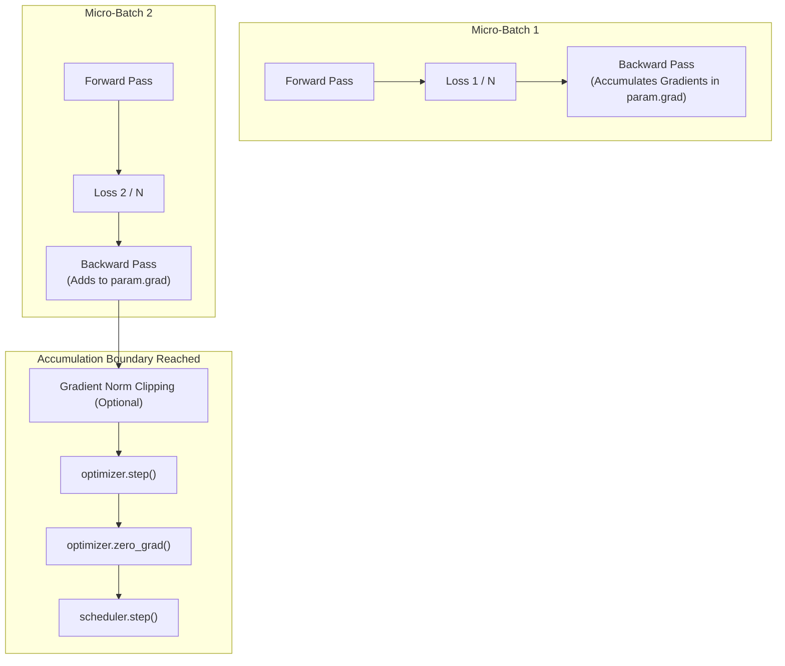

# Gradient Accumulation

Gradient accumulation is a training technique that enables using large effective batch sizes without exceeding available GPU hardware memory. Instead of updating model weights after every micro-batch, gradients are accumulated across multiple consecutive micro-steps before stepping the optimizer.

$$\text{Effective Batch Size} = \text{Micro-Batch Size} \times \text{Accumulation Steps} \times \text{Number of GPUs}$$

StackFormer provides native gradient accumulation within both `Engine` and `Trainer`.

---

## How It Works



### Mathematical Scaling
To ensure that the magnitude of accumulated gradients matches an equivalent large batch, each micro-batch loss is scaled down by the accumulation factor $N$:

$$\mathcal{L}_{\text{scaled}} = \frac{1}{N} \mathcal{L}_{\text{micro}}$$

$$\nabla_\theta \mathcal{L} = \sum_{k=1}^N \nabla_\theta \left( \frac{\mathcal{L}_k}{N} \right) = \frac{1}{N} \sum_{k=1}^N \nabla_\theta \mathcal{L}_k$$

---

## Configuring Gradient Accumulation

### In `Trainer`

Set `grad_accumulation_step` to your desired accumulation factor:

```python
from stackformer.engine import Trainer

trainer = Trainer(
    model=model,
    train_dataloader=train_loader,      # E.g. batch_size = 4
    grad_accumulation_step=8,           # Accumulate across 8 batches
    max_grad_norm=1.0,                  # Clipped on full accumulated gradient
)
# Effective batch size = 4 * 8 = 32
trainer.fit()
```

### In `Engine`

Direct step control with `grad_accum_steps`:

```python
from stackformer.engine import Engine, TrainingState

engine = Engine(
    state=state,
    grad_accum_steps=4,
    max_grad_norm=1.0,
)
```

---

## Memory vs. Throughput Tradeoffs

| Setting | Small Batch Size (No Accumulation) | Large Batch Size (Single Step) | Gradient Accumulation |
| :--- | :--- | :--- | :--- |
| **GPU Memory Usage** | Low | High (OOM risk) | **Low** |
| **Weight Update Frequency** | High | Low | Low |
| **Statistical Noise** | High | Low | Low |
| **Max Context Length Allowed** | High | Low | **High** |

---

## Interaction with AMP and DDP

1. **Automatic Mixed Precision (AMP)**: Gradients are scaled dynamically by `AMPScaler` during each micro-batch backward pass. Unscaling and gradient clipping occur only at the accumulation boundary immediately prior to the optimizer step.
2. **Distributed Training (DDP)**: In multi-GPU setups, the effective batch size multiplies across all workers. If running 4 GPUs with micro-batch 4 and accumulation factor 8:
   $$\text{Total Batch Size} = 4 \times 8 \times 4 = 128$$

