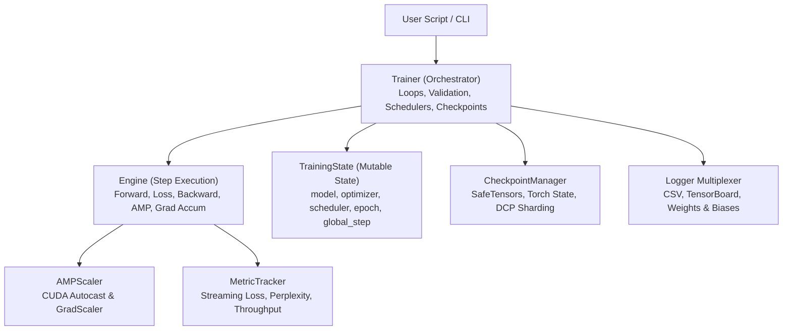

# Training Subsystem

StackFormer provides a modular, production-ready training subsystem designed for both single-device experimentation and distributed multi-GPU training. Rather than imposing rigid abstractions, StackFormer decouples state management, step execution, and high-level orchestration.

---

## Architectural Hierarchy



---

## Core Components

| Component | Module | Responsibility |
| :--- | :--- | :--- |
| **`Trainer`** | `stackformer.engine.trainer` | High-level training loop coordinator managing epochs, evaluation, checkpointing, and callbacks. |
| **`Engine`** | `stackformer.engine.engine` | Low-level step executor handling forward/backward passes, micro-batch accumulation, and optimizer stepping. |
| **`TrainingState`** | `stackformer.engine.state` | Unified dataclass holding references to model, optimizer, scheduler, device, epoch counter, and global step. |
| **`CheckpointManager`** | `stackformer.engine.checkpoint` | Safe serialization using SafeTensors for weights, PyTorch `.pt` for training state, and PyTorch Distributed Checkpoint (DCP) for sharded weights. |
| **`AMPScaler`** | `stackformer.amp` | Safe float16 / bfloat16 mixed precision execution with automatic dynamic loss scaling. |
| **`Logger`** | `stackformer.logging` | Unified metric sink multiplexing to CSV logs, TensorBoard events, and Weights & Biases runs. |
| **`Distributed (DDP)`** | `stackformer.distributed` | Process group initialization, DDP wrapping, DistributedSampler construction, and rank synchronization. |
| **Optimizers & Schedulers** | `stackformer.optim` | Factory functions with automatic weight-decay parameter grouping and learning rate schedules. |

---

## Minimal Training Example

```python
import torch
from torch.utils.data import DataLoader, TensorDataset
from stackformer.models import GPT2
from stackformer.engine import Trainer

# 1. Model & Mock Data
model = GPT2(vocab_size=1000, num_layers=4, embed_dim=256, num_heads=4, seq_len=128)
inputs = torch.randint(0, 1000, (64, 128))
targets = inputs.clone()
dataset = TensorDataset(inputs, targets)
train_loader = DataLoader(dataset, batch_size=8, shuffle=True)

# 2. Configure Trainer
trainer = Trainer(
    model=model,
    train_dataloader=train_loader,
    max_epochs=3,
    lr=5e-4,
    optimizer_name="adamw",
    scheduler_name="cosine",
    use_amp=torch.cuda.is_available(),
    device="auto",
    checkpoint_dir="checkpoints/gpt2_run",
)

# 3. Fit
trainer.fit()
```

---

## Detailed Training Guides

Explore each topic in depth:

- [Trainer API](trainer.md): Full documentation of constructor arguments and `.fit()` workflow.
- [Engine & Step Execution](engine.md): Micro-batching, loss computation, and `TrainingState`.
- [Mixed Precision (AMP)](mixed-precision.md): Memory efficiency and dynamic scaling with `AMPScaler`.
- [Distributed Training (DDP)](distributed-training.md): Multi-GPU setup, synchronization, and `torchrun`.
- [Gradient Accumulation](gradient-accumulation.md): Scaling effective batch size without GPU memory spikes.
- [Optimizers & Schedulers](optimizers-and-schedulers.md): Weight decay parameter grouping, cosine decay, and warmup.
- [Checkpointing](checkpointing.md): SafeTensors export, resuming training, and sharded DCP checkpoints.
- [Logging & Metrics](logging.md): Tracking accuracy, perplexity, and metrics across backends.

