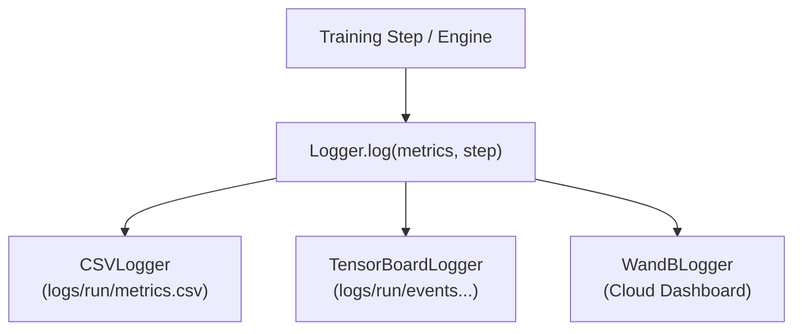

# Logging & Metrics

StackFormer features an extensible logging and metric tracking infrastructure in `stackformer.logging`. It provides unified multiplexing across disk CSV files, TensorBoard events, and Weights & Biases dashboards, paired with distributed streaming metric accumulation.

---

## The `Logger` Multiplexer

The `Logger` class accepts a single dictionary of metrics and routes values concurrently to all active logging backends. Backend crashes (e.g., temporary network interruption to cloud dashboards) are caught and isolated, preventing training job crashes.



### Constructor Parameters

```python
from stackformer.logging import Logger

logger = Logger(
    csv=True,
    tensorboard=True,
    wandb=False,
    log_dir="experiments/logs",
    experiment_name="gpt2_base_run",
    wandb_project="stackformer-models",
    wandb_config={"batch_size": 32, "lr": 3e-4},
)
```

| Parameter | Type | Default | Description |
| :--- | :--- | :--- | :--- |
| `csv` | `bool` | `True` | Write metric history to a persistent CSV spreadsheet file. |
| `tensorboard` | `bool` | `False` | Stream scalar values to TensorBoard event logs. |
| `wandb` | `bool` | `False` | Stream metrics and charts to Weights & Biases (requires `wandb` package). |
| `log_dir` | `str` | `"logs"` | Root directory where logs and event files will be created. |
| `experiment_name` | `str` | `"run"` | Experiment folder identifier suffix. |
| `wandb_project` | `str` | `"stackformer"` | Project namespace on Weights & Biases. |
| `wandb_config` | `dict \| None`| `None` | Hyperparameter dictionary recorded in W&B overview. |

### Logging Metrics

```python
# Log training metrics at a given global step
logger.log({"train/loss": 2.45, "train/lr": 3e-4, "train/tokens_per_sec": 14200.0}, step=100)

# Flush and close sinks cleanly
logger.close()
```

---

## `MetricTracker`

The `MetricTracker` records windowed running metrics, calculates step throughput, and computes epoch-level summaries.

```python
from stackformer.logging.metrics import MetricTracker

tracker = MetricTracker()

# Update running statistics within batch loop
tracker.update("loss", 2.15, count=batch_size)
tracker.update("accuracy", 0.88, count=batch_size)

# Compute epoch average
summary = tracker.compute_epoch_metrics()
print(summary)
# {"loss": 2.15, "accuracy": 0.88}

# Reset before next epoch
tracker.reset()
```

---

## Built-In Metric Utilities

StackFormer includes specialized metric calculation functions in `stackformer.logging.metrics`:

### Perplexity

Computes exponentiated cross-entropy loss:

$$\text{PPL} = \exp(\mathcal{L})$$

```python
from stackformer.logging.metrics import perplexity

ppl = perplexity(loss=2.302)
print("Perplexity:", ppl)  # ~10.0
```

### Classification Accuracy

```python
from stackformer.logging.metrics import accuracy

# Supports both raw logits (B, C) and predicted labels (B,)
acc = accuracy(preds=logits, targets=labels)
print(f"Batch Accuracy: {acc * 100:.2f}%")
```

### Distributed Mean Reduction

Calculates an all-reduce scalar average across all active DDP workers:

```python
from stackformer.logging.metrics import distributed_mean

# Synchronizes and averages scalar across all GPUs
global_mean_loss = distributed_mean(local_loss)
```

---

## Integrating Logging with `Trainer`

Pass the `Logger` instance to `Trainer.monitor`:

```python
from stackformer.engine import Trainer
from stackformer.logging import Logger

logger = Logger(csv=True, tensorboard=True, experiment_name="llama_pretrain")

trainer = Trainer(
    model=model,
    train_dataloader=train_loader,
    val_dataloader=val_loader,
    monitor=logger,
)
trainer.fit()
```

