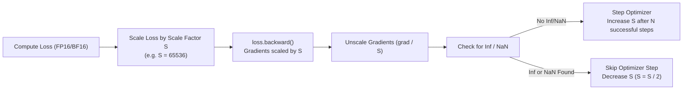

# Mixed-Precision Training (AMP)

Automatic Mixed Precision (AMP) accelerates deep learning training and significantly reduces GPU memory consumption by executing select operations in lower precision formats (typically FP16 or BF16) while maintaining numeric stability with FP32 master weights.

StackFormer provides native AMP integration through the `stackformer.amp` module and the `AMPScaler` class, supporting both modern `torch.amp` interfaces and legacy CUDA implementations with automatic fallback on CPU.

---

## Why Use Mixed Precision?

1. **Reduced Memory Footprint**: FP16 / BF16 tensors require 2 bytes per element instead of 4 bytes in FP32, cutting activation and weight storage in half.
2. **Tensor Core Acceleration**: Modern NVIDIA GPUs (Volta, Turing, Ampere, Ada Lovelace, Hopper, Blackwell) contain dedicated Tensor Cores that execute FP16/BF16 matrix multiplications significantly faster than FP32.
3. **Larger Batch Sizes**: Reduced activation memory allows training with 2x to 4x larger effective batch sizes or longer context windows.

---

## Dynamic Loss Scaling Mechanics

Because FP16 has a narrow dynamic range ($\sim 6 \times 10^{-5}$ to $65504$), small gradients in backpropagation can underflow to zero. `AMPScaler` prevents this using dynamic loss scaling:



---

## `AMPScaler` API

### Constructor Parameters

```python
from stackformer.amp import AMPScaler

scaler = AMPScaler(enabled=True, device_type="cuda")
```

| Parameter | Type | Default | Description |
| :--- | :--- | :--- | :--- |
| `enabled` | `bool` | `True` | Whether AMP is requested. If CUDA is not available on the system, automatically resolves to `False`. |
| `device_type` | `str` | `"cuda"` | Compute device type (`"cuda"`, `"mps"`, or `"cpu"`). |

### Core Methods

| Method | Return Type | Description |
| :--- | :--- | :--- |
| `autocast()` | Context Manager | Context manager executing inner forward operations in reduced precision. If `enabled=False`, returns a no-op `nullcontext()`. |
| `scale(loss)` | `torch.Tensor` | Multiplies the loss tensor by the current scale factor. |
| `unscale_(optimizer)` | `None` | Divides gradients by the scale factor before gradient norm clipping. |
| `step(optimizer)` | `None` | Unscales gradients and invokes `optimizer.step()` if no infinities or NaNs are detected. |
| `update()` | `None` | Adjusts the dynamic scale factor for the next iteration. |

---

## Usage in Custom Training Loops

```python
import torch
from stackformer.models import GPT2
from stackformer.amp import AMPScaler

device = "cuda" if torch.cuda.is_available() else "cpu"
model = GPT2(vocab_size=10000, num_layers=6, embed_dim=384, num_heads=6, seq_len=128).to(device)
optimizer = torch.optim.AdamW(model.parameters(), lr=1e-4)

# Initialize AMP Scaler
scaler = AMPScaler(enabled=torch.cuda.is_available(), device_type="cuda")

for batch_idx in range(100):
    inputs = torch.randint(0, 10000, (8, 128), device=device)
    targets = inputs.clone()
    optimizer.zero_grad()

    # 1. Forward pass under autocast context
    with scaler.autocast():
        logits = model(inputs)
        loss = torch.nn.functional.cross_entropy(logits.view(-1, 10000), targets.view(-1))

    # 2. Backward pass with scaled loss
    scaler.scale(loss).backward()

    # 3. Unscale and clip gradients (optional)
    scaler.unscale_(optimizer)
    torch.nn.utils.clip_grad_norm_(model.parameters(), max_norm=1.0)

    # 4. Step optimizer and update scale factor
    scaler.step(optimizer)
    scaler.update()
```

---

## Enabling AMP in `Trainer`

When using StackFormer's `Trainer`, enabling mixed-precision requires a single parameter:

```python
from stackformer.engine import Trainer

trainer = Trainer(
    model=model,
    train_dataloader=train_loader,
    use_amp=True,  # Automatically creates and manages AMPScaler
    max_grad_norm=1.0,
)
trainer.fit()
```

`Trainer` automatically takes care of:
- Unscaling gradients before clipping with `max_grad_norm`.
- Skipping corrupted steps containing infinities.
- Adjusting scale factors across gradient accumulation micro-batches.

