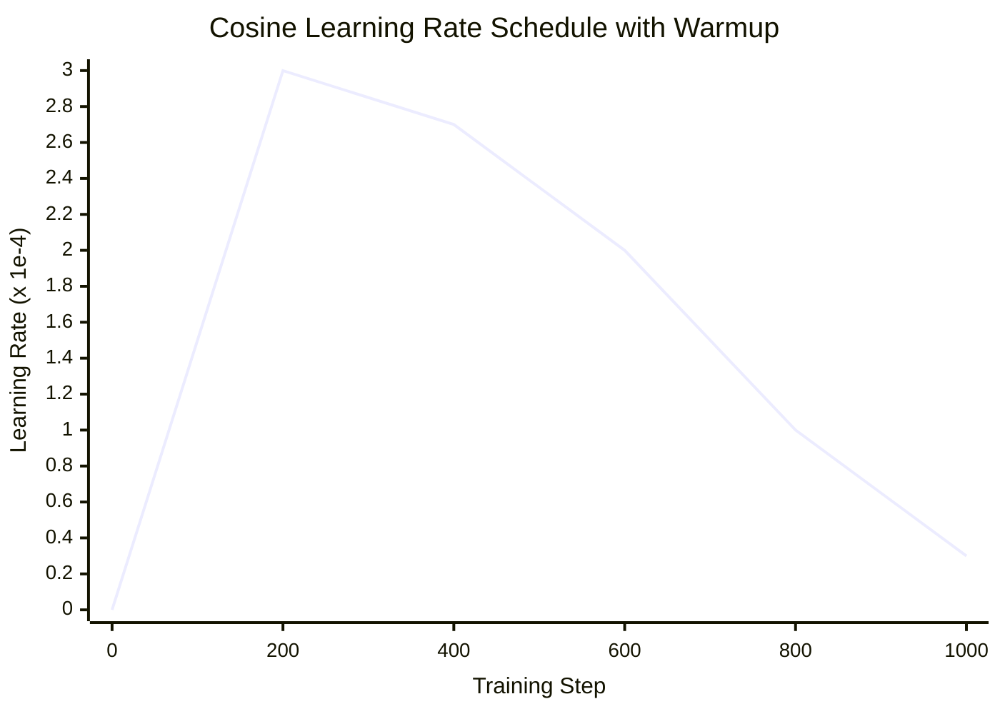

# Optimizers, Schedulers & Losses

StackFormer provides factory utilities and parameter-grouping routines inside `stackformer.optim` to configure optimizers, learning rate schedules, and loss functions for Transformer architectures.

---

## Weight Decay Parameter Grouping

Standard deep learning practice dictates that weight decay should only be applied to multidimensional matrix weights (e.g., in linear projections and convolutions), while biases and normalization scale/shift parameters (LayerNorm, RMSNorm) should be excluded to avoid suboptimal shrinkage.

StackFormer automates this through `get_parameter_groups`:

```python
from stackformer.optim.factories import get_parameter_groups

param_groups = get_parameter_groups(model, weight_decay=0.01)
# Returns:
# [
#     {"params": [weights...], "weight_decay": 0.01},
#     {"params": [biases, norms, embeddings...], "weight_decay": 0.0}
# ]
```

### Module Classification Rules

| Classification | Modules / Parameters Included | Weight Decay Applied |
| :--- | :--- | :--- |
| **Decayed Parameters** | `nn.Linear.weight`, `nn.Conv1d.weight`, `nn.Conv2d.weight` | `weight_decay` value |
| **No-Decay Parameters** | `nn.LayerNorm`, `nn.BatchNorm`, `RMSNorm`, `nn.Embedding`, all `.bias` vectors | `0.0` |

---

## Creating Optimizers

The `create_optimizer` factory inspects the model, groups parameters with appropriate weight decay, and instantiates the selected optimizer.

```python
from stackformer.optim import create_optimizer

optimizer = create_optimizer(
    model=model,
    optimizer_name="adamw",     # "adamw", "adam", "sgd", "rmsprop", "adagrad"
    lr=3e-4,
    weight_decay=0.01,
    betas=(0.9, 0.999),
    eps=1e-8,
)
```

| Parameter | Type | Default | Description |
| :--- | :--- | :--- | :--- |
| `model` | `nn.Module` | *required* | Model whose parameters will be optimized. |
| `optimizer_name` | `str` | `"adamw"` | Identifier for optimizer (`"adamw"`, `"adam"`, `"sgd"`, `"rmsprop"`, `"adagrad"`). |
| `lr` | `float` | `3e-4` | Base learning rate. |
| `weight_decay` | `float` | `0.01` | Weight decay penalty coefficient. |
| `betas` | `tuple[float, float]` | `(0.9, 0.999)` | Coefficients for computing running averages of gradient and its square in Adam/AdamW. |
| `eps` | `float` | `1e-8` | Term added to denominator for numerical stability. |

---

## Creating Learning Rate Schedulers

StackFormer includes factory support for common Transformer learning rate schedules with built-in linear warmup:

```python
from stackformer.optim import create_scheduler

scheduler = create_scheduler(
    optimizer=optimizer,
    scheduler_name="cosine",
    total_steps=10000,
    warmup_steps=500,
    min_lr_ratio=0.1,  # Final lr = lr * 0.1
)
```

### Supported Schedules

| Identifier | Schedule | Warmup Support | Description |
| :--- | :--- | :--- | :--- |
| **`"cosine"`** | Cosine Annealing | Yes | Linearly increases from $0$ to $\text{lr}$ during warmup, then decays following a half cosine wave down to $\text{lr} \times \text{min\_lr\_ratio}$. |
| **`"linear"`** | Linear Decay | Yes | Linearly warms up, then linearly decays learning rate to $0$. |
| **`"step"`** | Step Decay | No | Multiplies learning rate by `gamma` every `step_size` epochs. |
| **`"plateau"`** | Reduce on Plateau | No | Decays learning rate when a monitored metric (e.g. `val_loss`) stops improving. |
| **`"none"`** | Constant | No | Keeps constant learning rate throughout training. |



---

## Loss Functions

StackFormer provides domain-tailored loss functions in `stackformer.optim.loss_fn`:

### Language Modeling Cross-Entropy

```python
from stackformer.optim import language_modeling_cross_entropy

loss = language_modeling_cross_entropy(
    logits=logits,          # Shape: (B, T, V)
    labels=targets,         # Shape: (B, T)
    ignore_index=-100,      # Masked / padding tokens to ignore
    label_smoothing=0.0,
)
```

### Vision Classification Cross-Entropy

```python
from stackformer.optim.loss_fn import classification_cross_entropy

loss = classification_cross_entropy(
    logits=logits,          # Shape: (B, num_classes)
    labels=labels,          # Shape: (B,)
    label_smoothing=0.1,
)
```

### Semantic Segmentation Loss

```python
from stackformer.optim.loss_fn import segmentation_cross_entropy

loss = segmentation_cross_entropy(
    logits=logits,          # Shape: (B, num_labels, H, W)
    labels=masks,           # Shape: (B, H, W)
    ignore_index=255,       # Background / void category
)
```

